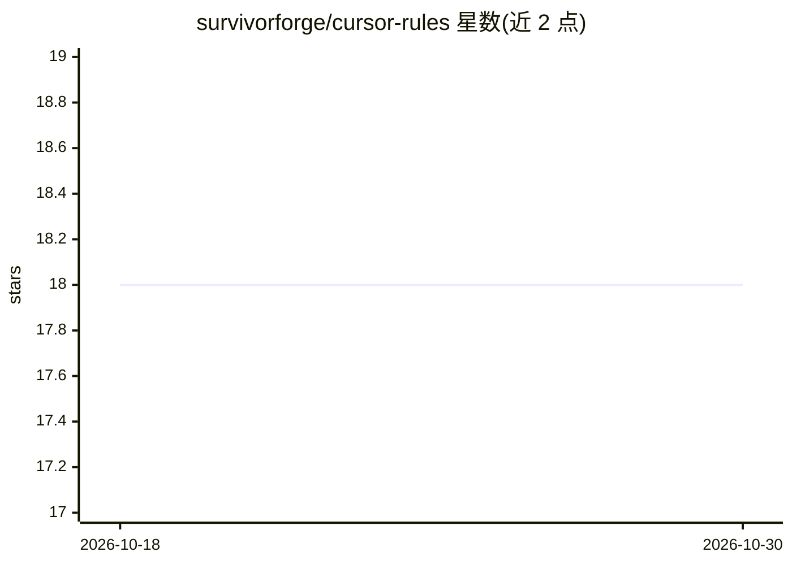

# survivorforge/cursor-rules

⭐ 18 · MIT · 推送 2026-04-17 · [GitHub](https://github.com/survivorforge/cursor-rules) · [官网](https://survivorforge.surge.sh/cursorrules-generator.html) · 个人维护

**Cursor IDE 的 .cursorrules 规则文件策展库（39+ 框架）**

面向 Cursor IDE（AI 代码编辑器）用户的 .cursorrules 规则文件集合：收录 39+ 个覆盖前端（React/Next.js/SvelteKit）、后端（FastAPI/Django/Go/Rust）、全栈云、语言及 AI Agent 工具链（LangChain、MCP Server）的规则文件。使用方式为将文件复制或 curl 下载到项目根目录，Cursor 自动检测并按规则生成代码。仓库另提供免费在线规则生成器，并在 Gumroad 出售包含全部规则与附加内容的付费 Mega Pack。

## 筛选速览

| 维度 | 判定 | 备注 |
|---|---|---|
| AI 角色 | `ai-knowledge` | 知识聚合/清单类 |
| 许可风险 | `permissive` | MIT |
| 部署形态 | `None` |  |
| 模型依赖 | — | README 未给出锁定关系 |
| 硬件要求 | — | 无带数字的原话,不猜 |
| 安装摩擦 | `low` | 无编译、无系统依赖或容器化 |
| 成熟度 | — | 结构信号不足 |

## 能力要点

- 39+ 个框架/技术栈专属的 .cursorrules 规则文件
- 覆盖前端、后端、全栈云、语言与 AI Agent 工具（LangChain/MCP）
- 提供在线自定义规则生成器与 curl 一键下载方式

## 适用场景

- 让 Cursor 按我的技术栈约定生成风格一致的代码
- 为 React/Next.js/Python 等项目快速接入现成编码规则
- 为 AI coding 助手配置错误处理、测试与安全规范

## 场景标签

`提示工程` · 领域:Agent 开发

## 证据(README 行号)

> L3: > **39+ ready-to-use `.cursorrules` files for Cursor IDE** — supercharge your AI coding assistant with framework-spe
> L10: Cursor is an AI-powered code editor. `.cursorrules` files tell Cursor's AI about your project's conventions, tech s
> L12: Drop a `.cursorrules` file in your project root, and Cursor automatically uses it to generate better, more consiste

## 星数曲线

2026-10-18 18 → 2026-10-30 18（+0）

---
*卡片 v1 · prompt 1.4 · 生成 2026-10-29 · 置信度 high · 依据 README sha `1aa5d53b874f` · [字段定义](../../DATASET.md)*
