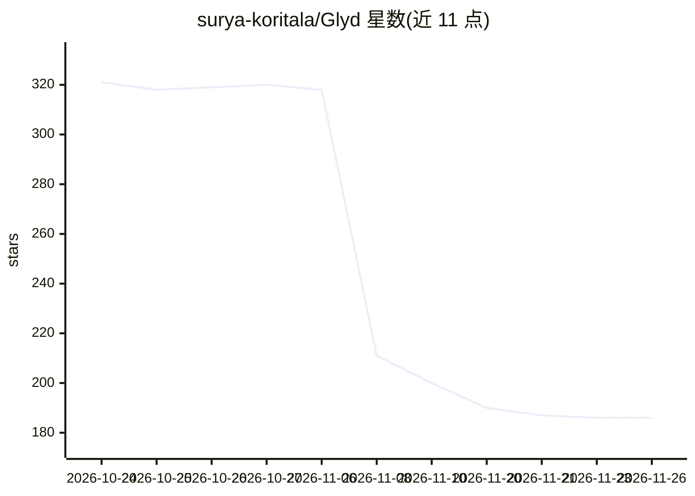

# surya-koritala/Glyd

⭐ 186 · Rust · Apache-2.0 · 推送 2026-11-25 · [GitHub](https://github.com/surya-koritala/Glyd) · [官网](https://surya-koritala.github.io/Glyd/guide/) · 个人维护

**单程序 Rust LLM 推理引擎，无损压缩权重与 KV cache**

用 Rust 编写、自带 CUDA kernel 的开源大模型推理引擎：对模型权重和 KV cache 做无损或有损压缩（penguin/kestrel/swift/wren/hummingbird 五级），按机器的 GPU、内存与磁盘规划模型部署，通过 OpenAI、Anthropic、Ollama 兼容 API 提供服务，支持多 GPU 拆分与多机部署，内置结构化输出、后台服务与 Prometheus/OpenTelemetry 运维能力。面向需要在自有硬件上运行开源模型的开发者，提供 Linux/Windows 安装脚本，从源码构建需 CUDA toolkit 12.8+。

## 筛选速览

| 维度 | 判定 | 备注 |
|---|---|---|
| AI 角色 | `ai-ecosystem` | LLM/agent 周边工具 |
| 许可风险 | `permissive` | Apache-2.0 |
| 部署形态 | `library` | 以包/库形式分发 |
| 模型依赖 | local-ok | 支持本地模型 |
| 硬件要求 | — | 无带数字的原话,不猜 |
| 安装摩擦 | `high` | 编译与系统依赖俱全 |
| 成熟度 | — | 结构信号不足 |

## 能力要点

- 五级压缩（penguin 无损至 hummingbird 2-3 bit 专家压缩）与 KV cache 12-bit 无损存储
- OpenAI/Anthropic/Ollama 三种兼容 API，一个程序无 Python 依赖
- glyd fit 规划器按 GPU/内存/磁盘自动选择压缩级别
- 多 GPU 拆分、MoE 专家驻留内存/NVMe、多机部署（beta）

## 适用场景

- 在笔记本电脑到多 GPU 服务器上运行开源大模型
- 为开发工具提供本地 OpenAI/Ollama 兼容 API 端点
- 用 MoE offload 在显存不足时运行超大模型
- 对已发布权重做位级无损压缩分发

## 场景标签

`推理引擎` `模型量化` · 领域:训练与推理

## 证据(README 行号)

> L20: Glyd is an open-source inference engine for large language models, written in Rust with its own CUDA kernels. It
> L22: and disk you have, and serves it with OpenAI-, Anthropic- and Ollama-compatible APIs. One program, no Python.

## 星数曲线

2026-10-24 321 → 2026-11-26 186（-135）

---
*卡片 v1 · prompt 1.4 · 生成 2026-11-26 · 置信度 mid · 依据 README sha `6ed818e200dd` · [字段定义](../../DATASET.md)*
