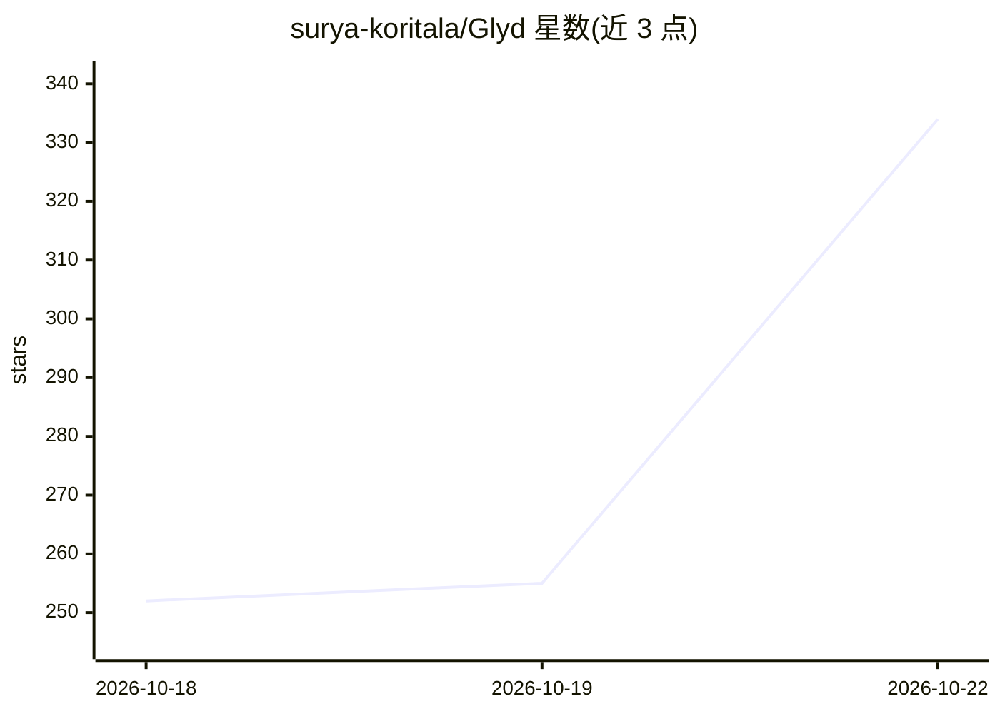

# surya-koritala/Glyd

⭐ 320 · Rust · NOASSERTION · 推送 2026-10-17 · [GitHub](https://github.com/surya-koritala/Glyd) · [官网](https://github.com/surya-koritala/Glyd#readme) · 个人维护

**给 LLM 推理用户的无损压缩运行时：省约三成 GPU 显存**

Glyd 将 bf16 模型权重与 KV cache 以更少位数驻留 GPU 显存，并在模型运行时逐位重建原值（权重与 KV 均可读回精确 bf16；exact=True 可得到与 bf16 完全一致的 logits）。释放的显存可用于更长上下文或更多并发请求。提供 CLI（glyd run 直接对话）与 Python API（glyd.from_pretrained），支持 vLLM 集成（--quantization glyd），另有有损低位变体（:kestrel 6.5 bits、:swift 5.5 bits）。底层是带 C ABI 的 Rust 无损压缩库，可作 LZ4/Snappy/zstd 替代。限制：需 Linux + NVIDIA GPU（Ampere 及以后，驱动 580+），v2.29.0 起整体为 BUSL-1.1 许可。

## 筛选速览

| 维度 | 判定 | 备注 |
|---|---|---|
| AI 角色 | `ai-ecosystem` | LLM/agent 周边工具 |
| 许可风险 | `none` | NOASSERTION |
| 部署形态 | `library` | 以包/库形式分发 |
| 模型依赖 | local-ok | 支持本地模型 |
| 硬件要求 | — | 无带数字的原话,不猜 |
| 安装摩擦 | `low` | 无编译、无系统依赖或容器化 |
| 成熟度 | — | 结构信号不足 |

## 能力要点

- bf16 权重与 KV cache 逐位无损重建，输出与 bf16 logits 一致（exact=True）
- 支持 vLLM（--quantization glyd）与 Python API 两种接入方式
- CLI 直接运行 HuggingFace 模型并提供终端对话，另有 6.5/5.5 bits 有损变体
- Rust + C ABI 的通用无损压缩库，含 typed columns（-r）与 delta（--base）模式

## 适用场景

- 在单张 24GB 消费级显卡上跑更大模型或更长上下文
- 推理服务在同等 GPU 上容纳更长上下文（如 18 万 token）或更多并发
- 作为 LZ4/Snappy/zstd 的替代压缩日志与表格转储文件

## 场景标签

 · 领域:LLM 推理基础设施/压缩

## 证据(README 行号)

> L8: Glyd keeps a bf16 model's weights and KV cache in fewer bits in GPU memory and rebuilds the exact values
> L20: With vLLM, or in Python:
> L24: vllm serve Qwen/Qwen3.5-9B --quantization glyd

## 星数曲线

2026-10-18 252 → 2026-10-22 334（+82）

---
*卡片 v1 · prompt 1.4 · 生成 2026-10-21 · 置信度 high · 依据 README sha `c8d7b6972a73` · [字段定义](../../DATASET.md)*
