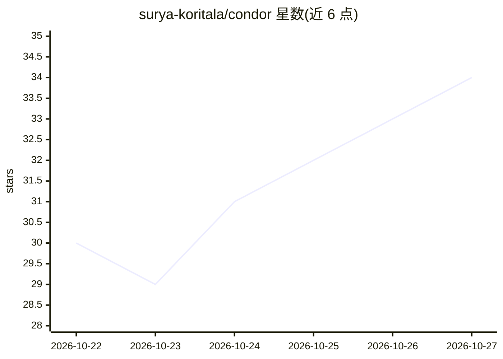

# surya-koritala/condor

⭐ 34 · Python · Apache-2.0 · 推送 2026-10-21 · [GitHub](https://github.com/surya-koritala/condor) · 个人维护

**单张 12-16GB NVIDIA GPU 本地运行 180B MoE 模型的自研推理引擎**

自研引擎加自压缩权重，把 Qwen3.8-Flash-Next（180B MoE）放到一张 12-16 GB NVIDIA 显卡上运行：路由到的专家驻留 GPU、其余放内存由 CPU 补算，按使用强度分级压缩专家位宽，配合草稿头投机解码与逐层处理长提示。提供 OpenAI/Anthropic 兼容 API、网页聊天页、MCP 接入、图像输入与多用户并发（默认 4 路）。分 precise/best/fast 三档模式，个人使用免费；仅限 RTX 30 系及以上，无 macOS。

## 筛选速览

| 维度 | 判定 | 备注 |
|---|---|---|
| AI 角色 | `ai-ecosystem` | LLM/agent 周边工具 |
| 许可风险 | `permissive` | Apache-2.0 |
| 部署形态 | `None` |  |
| 模型依赖 | — | README 未给出锁定关系 |
| 硬件要求 | `gpu-8g` | |
| 安装摩擦 | `medium` | 含编译或系统依赖之一 |
| 成熟度 | — | 结构信号不足 |

## 能力要点

- 专家按路由热度的 GPU/RAM 分置与按使用强度压缩位宽
- OpenAI 与 Anthropic 兼容 API、网页聊天页、MCP、图像输入
- 262,144 token 上下文，多用户流式并发（1-8 路）
- Linux 与 Windows 安装脚本，双卡分层部署支持

## 适用场景

- 在一张消费级显卡上本地运行 180B MoE 模型做对话与编码
- 通过 OpenAI/Anthropic 兼容 API 接入本地模型给现有客户端和 agent 框架
- 本地跑通后用 bench 工具自测吞吐与质量

## 场景标签

`推理引擎` `模型量化` · 领域:训练与推理

## 证据(README 行号)

> L3: Qwen3.8-Flash-Next (180B, MoE) on one 12-16 GB NVIDIA GPU with 32-64 GB of RAM, on Linux or Windows. Our own engine 
> L4: compressed weights. OpenAI- and Anthropic-compatible APIs, a chat page, MCP. Free for personal use. More Flash-class

## 星数曲线

2026-10-22 30 → 2026-10-27 34（+4）

---
*卡片 v1 · prompt 1.4 · 生成 2026-10-25 · 置信度 high · 依据 README sha `6340716b8878` · [字段定义](../../DATASET.md)*
