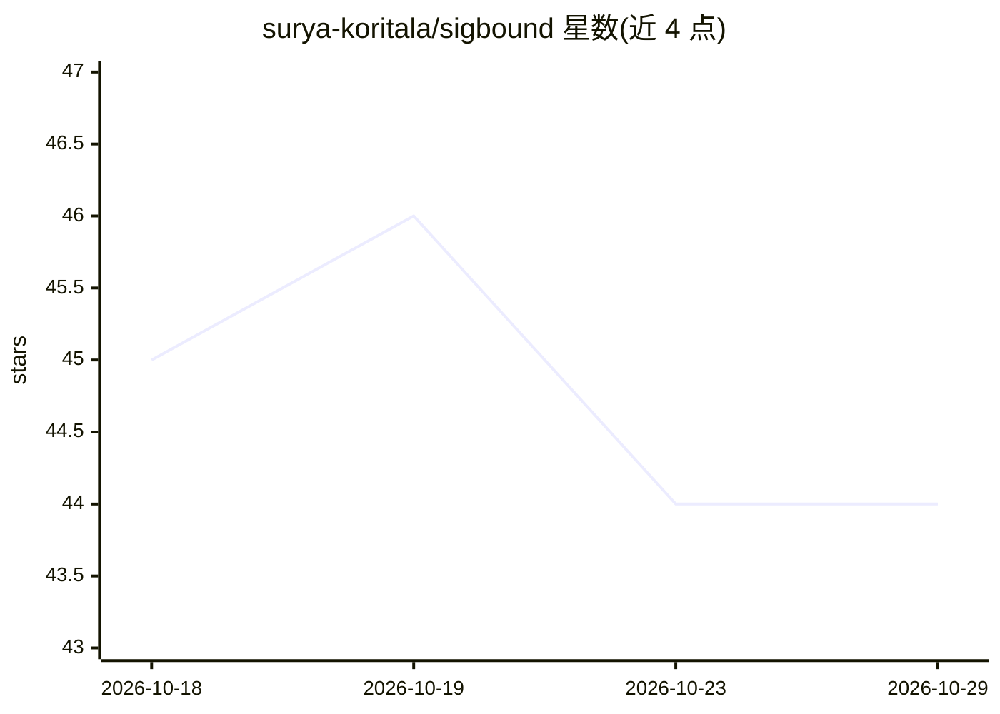

# surya-koritala/sigbound

⭐ 44 · Go · Apache-2.0 · 推送 2026-08-14 · [GitHub](https://github.com/surya-koritala/sigbound) · 个人维护

**在单一 git 仓库上并行运行多个 AI 编码 agent 并自动合并的工具**

Go 编写的 CLI，基于 git worktree 与 merge-tree 并行运行多个 AI 编码 agent，自动合并其产出：不冲突的改动并行合并，冲突由模型解决（低置信度标记人工审查），每次合并以用户提供的 build/test 命令为闸门，失败可路由到修复命令。planner/agent/resolver/repair 均为用户自供命令（自带模型），提供 claude/codex/aider 等预设。仅依赖 git 二进制（>=2.38），macOS/Linux 为主力平台，Windows 未充分验证。

## 筛选速览

| 维度 | 判定 | 备注 |
|---|---|---|
| AI 角色 | `ai-ecosystem` | LLM/agent 周边工具 |
| 许可风险 | `permissive` | Apache-2.0 |
| 部署形态 | `desktop` | 安装包/桌面程序 |
| 模型依赖 | — | README 未给出锁定关系 |
| 硬件要求 | — | 无带数字的原话,不猜 |
| 安装摩擦 | `low` | 无编译、无系统依赖或容器化 |
| 成熟度 | — | 结构信号不足 |

## 能力要点

- 并行合并多 agent 分支，合并结果以 -verify 命令（build+test）为闸门
- 模型解决冲突，低置信度标记人工审查而非猜测
- sigbound.policy 仓库级落地策略与敏感路径人工确认（run parking）
- 提供 sig serve HTTP 运行 API、sig log 运行账本与多机 export/import

## 适用场景

- 并行派发多个 AI 编码任务到同一仓库并安全合并
- 为 agent 产出设置必须通过构建与测试的落地门槛
- 多台机器分担一批 agent 任务后汇总合并

## 场景标签

`多智能体` `编码 Agent` · 领域:Agent 开发

## 证据(README 行号)

> L17: Sigbound handles the merge. It splits a task into independent pieces, runs an agent on each, combines the non-confl
> L19: Every model step — planning, the agents, conflict resolution, repair — is a command you provide, so you use your ow
> L34: - **Bring your own model** — planner, agent, resolver, and repair are each a command you supply.

## 星数曲线

2026-10-18 45 → 2026-10-29 44（-1）

---
*卡片 v1 · prompt 1.4 · 生成 2026-10-25 · 置信度 high · 依据 README sha `3fda52e3bd52` · [字段定义](../../DATASET.md)*
