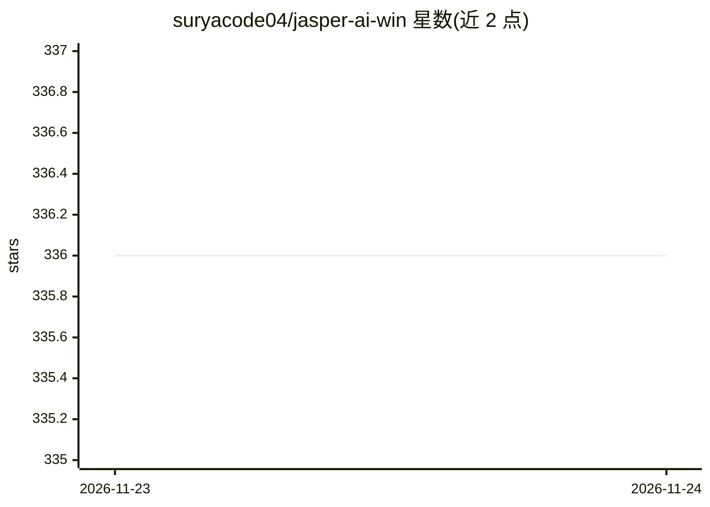

# suryacode04/jasper-ai-win

⭐ — · [GitHub]() · 个人维护

**Jasper AI 内容生成平台的 Windows 安装与使用指南**

该仓库本身是一份面向 Windows 10/11 用户的参考与安装指南，介绍 Jasper AI 内容生成平台的品牌声音定制、长文起草工作流与系统配置。内容覆盖系统要求（Windows 10/11、x64、.NET Framework 4.8、WebView2 等）、五步使用流程（安装、登录、定义品牌声音、起草导出）、FAQ 与故障排查。仓库不包含源代码，安装方式为从官方来源下载安装包。

## 筛选速览

| 维度 | 判定 | 备注 |
|---|---|---|
| AI 角色 | `ai-knowledge` | 知识聚合/清单类 |
| 许可风险 | `none` | — |
| 部署形态 | `None` |  |
| 模型依赖 | — | README 未给出锁定关系 |
| 硬件要求 | — | 无带数字的原话,不猜 |
| 安装摩擦 | `low` | 无编译、无系统依赖或容器化 |
| 成熟度 | — | 结构信号不足 |

## 能力要点

- 品牌声音（Brand Voice）配置：从写作样本与风格说明生成一致语气
- 模板库覆盖标题、广告、产品描述、邮件与落地页文案
- 五步工作流：安装、登录配置、品牌声音定义、起草与导出
- 系统要求与运行时依赖说明（WebView2、.NET 4.8、VC++ 运行库）

## 适用场景

- 在 Windows 上安装并配置 Jasper AI 工作区
- 为营销团队建立统一的品牌声音配置
- 排查安装后应用无法启动的依赖问题

## 场景标签

`AI 写作` · 领域:内容生成

## 证据(README 行号)

> L3:  A Windows reference and setup guide for the Jasper Ai content generation platform, brand voice controls, drafting w
> L19: Jasper Ai is an AI content generation platform built for creating marketing copy, adapting a consistent brand voice

## 星数曲线

2026-11-23 336 → 2026-11-24 336（+0）

---
*卡片 v1 · prompt 1.4 · 生成 2026-11-23 · 置信度 mid · 依据 README sha `be6d6ca84999` · [字段定义](../../DATASET.md)*
