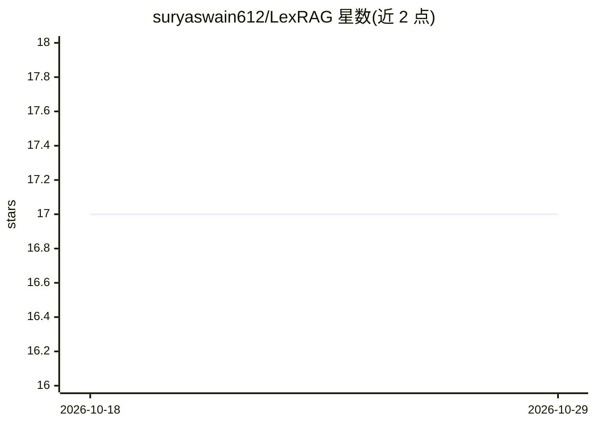

# suryaswain612/LexRAG

⭐ 17 · Jupyter Notebook · 推送 2026-08-24 · [GitHub](https://github.com/suryaswain612/LexRAG) · 个人维护

**面向法律文档检索问答的 RAG 应用，供法律从业者查询**

LexRAG 是一个法律文档检索问答应用：法律文档存入 PostgreSQL 并索引到 Elasticsearch，用户通过 Streamlit 界面提交查询，系统检索相关案例、法条等文档，并调用 Hugging Face 上的 Google BERT 模型（bert-large-uncased SQuAD 微调版，需 HUGGINGFACE_KEY）生成摘要与建议。数据摄取由 Airflow 编排（CSV/JSON → PostgreSQL → Elasticsearch），Grafana 提供实时监控看板（答题量、满意度、响应时间、Hit Rate/MRR）。整体通过 Docker Compose 部署。提供满意度反馈按钮与基于 Hit Rate/MRR/BERT 分数的评测。

## 筛选速览

| 维度 | 判定 | 备注 |
|---|---|---|
| AI 角色 | `ai-native` | 本体是模型或模型工具 |
| 许可风险 | `none` | — |
| 部署形态 | `self-host` | docker 或自建部署 |
| 模型依赖 | — | README 未给出锁定关系 |
| 硬件要求 | — | 无带数字的原话,不猜 |
| 安装摩擦 | `low` | 无编译、无系统依赖或容器化 |
| 成熟度 | — | 结构信号不足 |

## 能力要点

- PostgreSQL 存储 + Elasticsearch 全文索引的双层检索
- 通过 Hugging Face API 调用 Google BERT 模型生成摘要与建议
- Airflow 编排的 CSV/JSON 数据摄取与索引流水线
- Grafana 实时监控看板（满意度、响应时间、Hit Rate/MRR）

## 适用场景

- 法律从业者按自然语言查询案例法与法条
- 律所对法律文档库做自动化检索与摘要
- 跟踪法律问答系统的满意度与检索质量指标

## 场景标签

`RAG` · 领域:知识与检索

## 证据(README 行号)

> L11: The LexRAG aims to solve these challenges by implementing a Retrieval-Augmented Generation (RAG) approach, combined
> L47: 1. Integration with Google BERT API: To enhance the relevance and quality of the search results, the application le

## 星数曲线

2026-10-18 17 → 2026-10-29 17（+0）

---
*卡片 v1 · prompt 1.4 · 生成 2026-10-29 · 置信度 high · 依据 README sha `676f1a3fe72a` · [字段定义](../../DATASET.md)*
