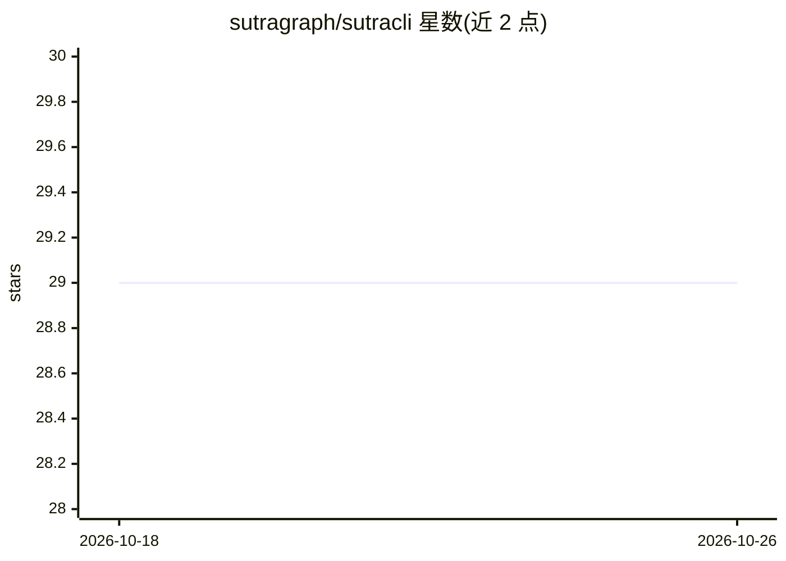

# sutragraph/sutracli

⭐ 29 · Python · GPL-3.0 · 推送 2025-11-07 · [GitHub](https://github.com/sutragraph/sutracli) · 组织维护

**面向编码 agent 的多项目代码库分析与编排 CLI**

Python 编写的命令行工具（PyPI 包名 sutrakit），对项目进行 AST 解析与嵌入索引，提供语义搜索与代码分析；核心组件包括生成跨项目变更计划的 Roadmap Agent、并行派发更新的子 agent 编排，以及通过标识符匹配构建跨项目依赖图的 Cross-Indexing 服务。LLM 提供商可在配置文件中切换（aws_bedrock、anthropic、openai、openrouter 等）。Tree-sitter 精细解析仅覆盖 Python/TypeScript/JavaScript，其他语言回退为分块索引。子 agent 需预先安装并认证 rovodev 或 gemini CLI。

## 筛选速览

| 维度 | 判定 | 备注 |
|---|---|---|
| AI 角色 | `ai-ecosystem` | LLM/agent 周边工具 |
| 许可风险 | `viral` | GPL-3.0 |
| 部署形态 | `library` | 以包/库形式分发 |
| 模型依赖 | locked-api |  |
| 硬件要求 | — | 无带数字的原话,不猜 |
| 安装摩擦 | `low` | 无编译、无系统依赖或容器化 |
| 成熟度 | — | 结构信号不足 |

## 能力要点

- Tree-sitter AST 解析与嵌入索引，支持语义搜索
- Roadmap Agent 生成跨项目最小变更计划并编排子 agent 执行
- Cross-Indexing 构建跨项目依赖图（API/消息队列/WebSocket 链接）
- LLM 提供商可通过 ~/.sutra/config/system.config 切换（8 种）

## 适用场景

- 微服务/全栈多项目生态中规划新功能或修复的跨库变更
- 为编码 agent 提供代码库索引与语义检索基础
- 梳理项目间依赖关系以做重构与集成分析

## 场景标签

`编码 Agent` `语义搜索` · 领域:编码与开发

## 证据(README 行号)

> L59: Sutrakit is an orchestrator for AI agents and services, focused on multi-project codebase analysis and management. 
> L67: - **Orchestration of Sub-Agents**:
> L120: 1. Update `"provider"` to one of: `"aws_bedrock"`, `"anthropic"`, `"google_ai"`, `"vertex_ai"`, `"azure_openai"`, 

## 星数曲线

2026-10-18 29 → 2026-10-26 29（+0）

---
*卡片 v1 · prompt 1.4 · 生成 2026-10-26 · 置信度 high · 依据 README sha `1e16b75076df` · [字段定义](../../DATASET.md)*
