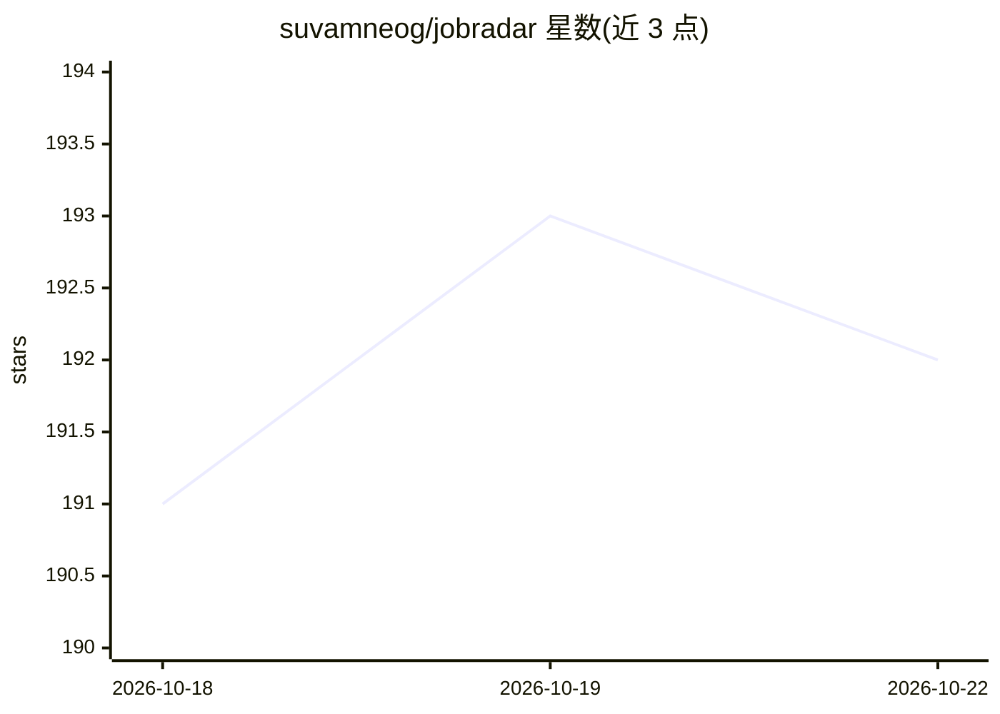

# suvamneog/jobradar

⭐ 193 · Python · MIT · 推送 2026-09-30 · [GitHub](https://github.com/suvamneog/jobradar) · 个人维护

**监控 56 家公司招聘板、用 LLM 按简历给职位打分的求职提醒工具**

Python 编写的职位监控与筛选工具：抓取 56 家公司在 Greenhouse、Lever、Ashby、Workable、Workday、Oracle Recruiting Cloud 七种 ATS 平台上的招聘板，检测新增与关闭的职位，由 LLM 阅读职位描述后对照简历 PDF 打出 0-10 分并给出理由；职级与相关性两条规则在代码中执行而非提示词中。支持每日邮件提醒、每周摘要、本地 Web UI 搜索过滤，并通过 launchd 注册定时任务（需 Mac 与 Python 3.11+）。LLM 走任意 OpenAI 兼容端点，默认 xkiro/Mistral Large 3 免费层；令牌预算逐请求检查，超限暂停下次续跑。MIT 许可。

## 筛选速览

| 维度 | 判定 | 备注 |
|---|---|---|
| AI 角色 | `ai-native` | 本体是模型或模型工具 |
| 许可风险 | `permissive` | MIT |
| 部署形态 | `None` |  |
| 模型依赖 | — | README 未给出锁定关系 |
| 硬件要求 | — | 无带数字的原话,不猜 |
| 安装摩擦 | `low` | 无编译、无系统依赖或容器化 |
| 成熟度 | — | 结构信号不足 |

## 能力要点

- 覆盖七种 ATS 平台、56 家公司的招聘板监控，职位以稳定 id 判定新增/关闭
- LLM 对照简历 PDF 打 0-10 分并给理由；职级与相关性规则在代码中强制执行
- 每日邮件+桌面提醒、周一排名摘要、本地 Web UI（localhost:8765）
- 令牌预算逐请求检查，340K token 全量扫描后仅对新增职位评分

## 适用场景

- 订阅目标公司列表，每天收邮件了解值得投递的新职位
- 应届生避免被高职级职位淹没，只看与自己级别匹配的岗位
- 在本地 Web UI 中搜索和过滤所有已抓取的职位

## 场景标签

 · 领域:求职/个人自动化

## 证据(README 行号)

> L16: - **Ranks against your resume.** 0–10 with a reason, from an LLM that reads the
> L17:  job description.
> L57: - An LLM key. Any OpenAI-compatible endpoint works; the default is

## 星数曲线

2026-10-18 191 → 2026-10-22 192（+1）

---
*卡片 v1 · prompt 1.4 · 生成 2026-10-22 · 置信度 high · 依据 README sha `ced708f1440d` · [字段定义](../../DATASET.md)*
