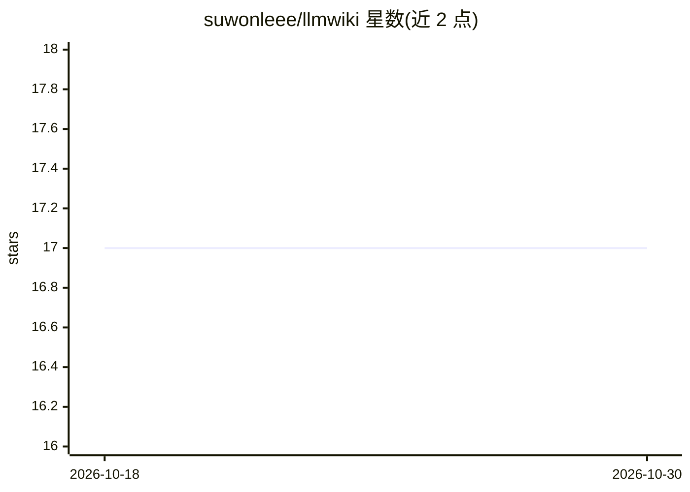

# suwonleee/llmwiki

⭐ 17 · TypeScript · Apache-2.0 · 推送 2026-10-19 · [GitHub](https://github.com/suwonleee/llmwiki) · 个人维护

**把编码 agent 会话沉淀为本地项目 wiki 并出题复习的工具**

面向使用 Claude Code、Codex、OpenCode 的开发者：llmwiki 在会话结束时把决策与项目上下文写入 docs/wiki/ 的 Markdown（Open Knowledge Format v0.2），后续会话自动检索相关片段与提交信息，并以 /wiki-quiz 遗忘曲线测验帮助用户记忆自己的决策。存储与检索在本地用 Bun 和 SQLite 运行，每个项目需显式 llmwiki init 才启用；需 Git、Bun 1.2.21+ 与一个编码 agent，通过 git clone 与 setup 脚本安装。

## 筛选速览

| 维度 | 判定 | 备注 |
|---|---|---|
| AI 角色 | `ai-ecosystem` | LLM/agent 周边工具 |
| 许可风险 | `permissive` | Apache-2.0 |
| 部署形态 | `None` |  |
| 模型依赖 | — | README 未给出锁定关系 |
| 硬件要求 | — | 无带数字的原话,不猜 |
| 安装摩擦 | `low` | 无编译、无系统依赖或容器化 |
| 成熟度 | — | 结构信号不足 |

## 能力要点

- 会话决策沉淀为 git 内的 Markdown wiki（OKF v0.2，带溯源与日期日志）
- /wiki-quiz 按遗忘曲线出题帮助记忆项目决策
- 会话启动上下文与逐提示检索，可含提交信息并报告条目缺失
- 存储与检索本地运行（Bun + SQLite），项目级默认关闭、init 显式启用

## 适用场景

- 编码 agent 会话结束后归档决策与上下文，避免丢失
- 下次会话自动取回相关 wiki 片段作为上下文
- 用每日测验保持对自己项目决策的记忆

## 场景标签

`Agent 记忆` `知识库管理` · 领域:Agent 开发

## 证据(README 行号)

> L9: llmwiki turns coding sessions into a wiki in `docs/wiki/`. Claude Code, Codex and OpenCode can share it, retrieve re
> L11: - **Remember the work:** save decisions, insights and project context with `/wiki-save`.
> L14: - **Stay in control:** each project is off until `llmwiki init`; storage and search run locally with Bun and SQLite

## 星数曲线

2026-10-18 17 → 2026-10-30 17（+0）

---
*卡片 v1 · prompt 1.4 · 生成 2026-10-29 · 置信度 high · 依据 README sha `0ca9dd0b4f7c` · [字段定义](../../DATASET.md)*
