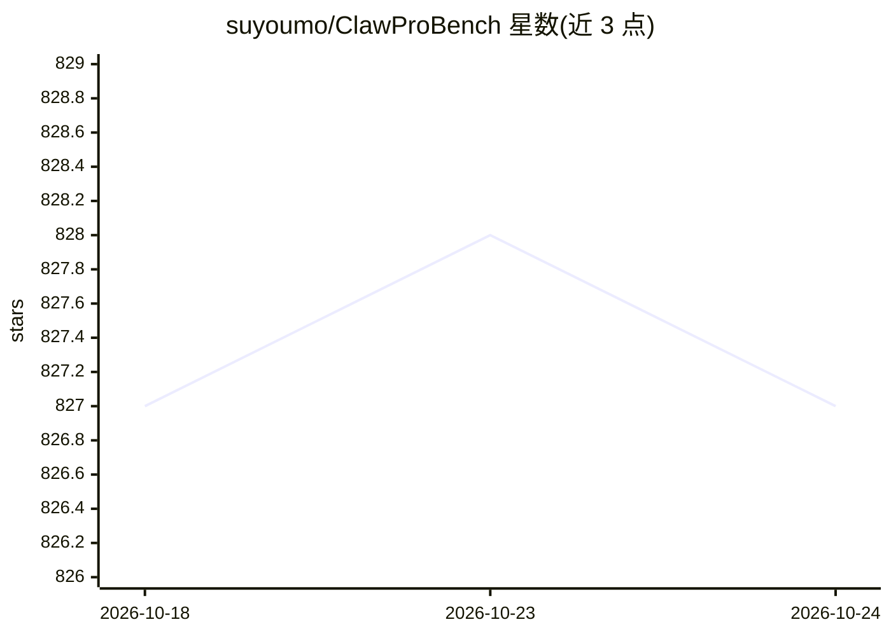

# suyoumo/ClawProBench

⭐ 827 · Rust · Apache-2.0 · 推送 2026-08-25 · [GitHub](https://github.com/suyoumo/ClawProBench) · [官网](https://suyoumo.github.io/bench/) · 个人维护 · 中文 README

**评测 OpenClaw 运行时中 LLM agent 能力的基准工具**

在本地 OpenClaw 运行时中对 LLM agent 做 live 执行评测的基准工具：提供 102 个活跃场景（目录共 164 个），按 core/intelligence/coverage/native/full 五种基准配置组织，采用确定性评分与多次试验（--trials N）可靠性度量（pass^3、pass@3、FinalScore）。运行需本地 openclaw CLI，通过 run.py 完成 inventory/dry/run/compare 流程，支持断点续跑与隔离运行；附带公开排行榜与 Hugging Face 数据集，并有 arXiv 论文。面向做模型评测与选型对比的研究者和开发者。

## 筛选速览

| 维度 | 判定 | 备注 |
|---|---|---|
| AI 角色 | `ai-ecosystem` | LLM/agent 周边工具 |
| 许可风险 | `permissive` | Apache-2.0 |
| 部署形态 | `library` | 以包/库形式分发 |
| 模型依赖 | — | README 未给出锁定关系 |
| 硬件要求 | — | 无带数字的原话,不猜 |
| 安装摩擦 | `low` | 无编译、无系统依赖或容器化 |
| 成熟度 | — | 结构信号不足 |

## 能力要点

- 102 个活跃场景、5 种基准配置（core 默认 26 个）
- 确定性评分与 pass^3/pass@3/FinalScore 多试验指标
- 支持断点续跑、失败重排队与同主机隔离运行
- 公开排行榜与 Hugging Face 数据集（xyh110sym/clawprobench）

## 适用场景

- 在本地 OpenClaw 环境中评测不同模型的 agent 任务表现
- 生成结构化报告做多模型对比
- 查看排行榜了解各模型在 agent 基准上的得分

## 场景标签

`模型评测` · 领域:评测与运维

## 证据(README 行号)

> L15: > Transparent live-first benchmark harness for evaluating model capability inside the OpenClaw runtime.
> L22: ClawProBench focuses on real OpenClaw execution with deterministic grading, structured reports, and benchmark-profi
> L87: - `v1.0.0` - ClawProBench released with 102 tasks across 6 domains, with 3-try runs, checkpoint resume, and cross-e

## 星数曲线

2026-10-18 827 → 2026-10-24 827（+0）

---
*卡片 v1 · prompt 1.4 · 生成 2026-10-21 · 置信度 high · 依据 README sha `69c52c4f3007` · [字段定义](../../DATASET.md)*
