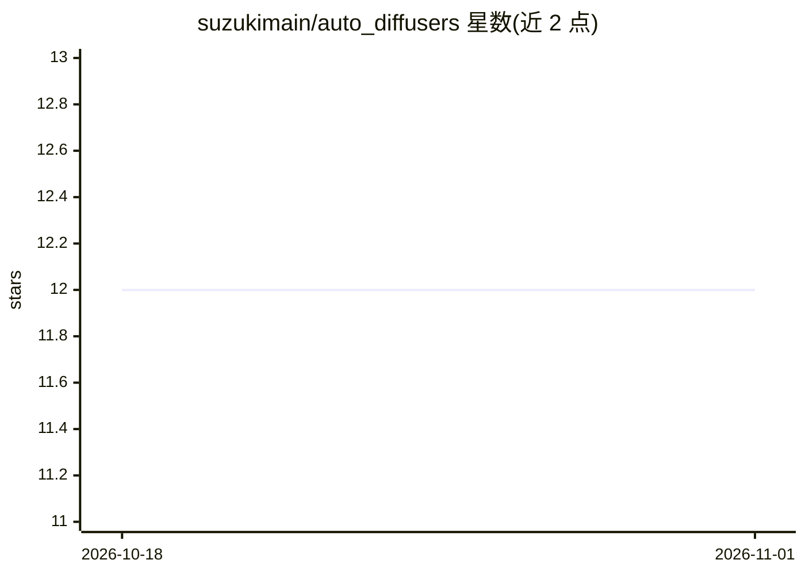

# suzukimain/auto_diffusers

⭐ 12 · Python · Apache-2.0 · 推送 2026-08-12 · [GitHub](https://github.com/suzukimain/auto_diffusers) · 个人维护

**给开发者的 diffusers 增强库：按关键词搜索并加载 HF/Civitai 模型**

在 Hugging Face diffusers 之上封装的 Python 库，提供 EasyPipelineForText2Image 等接口：按关键词、URL 或本地路径搜索 Hugging Face 与 Civitai 上的 Checkpoint、LoRA、TextualInversion、Controlnet 等模型，支持按 base_model 标签（SD 1.5/SD 3.5/SDXL）过滤，自动下载并加载进 pipeline，也可单独调用 search_civitai/search_huggingface 检索元数据；可自动加载 LoRA 与 TextualInversion。README 记录了 Civitai API 规格变更导致的检索精度下降问题及临时规避措施，部分模型可能搜不到。以 pip 包分发，Apache-2.0 许可。

## 筛选速览

| 维度 | 判定 | 备注 |
|---|---|---|
| AI 角色 | `ai-ecosystem` | LLM/agent 周边工具 |
| 许可风险 | `permissive` | Apache-2.0 |
| 部署形态 | `library` | 以包/库形式分发 |
| 模型依赖 | — | README 未给出锁定关系 |
| 硬件要求 | — | 无带数字的原话,不猜 |
| 安装摩擦 | `low` | 无编译、无系统依赖或容器化 |
| 成熟度 | — | 结构信号不足 |

## 能力要点

- EasyPipeline 按关键词/URL/路径搜索并加载 Hugging Face 与 Civitai 模型
- 支持 Checkpoint、LoRA、TextualInversion、Controlnet 等模型类型与 base_model 过滤
- auto_load_lora_weights / auto_load_textual_inversion 自动加载组件
- 搜索 API 出错时可通过 token 认证与 skip_error 规避

## 适用场景

- 在文生图脚本里按模型名关键词直接搜索并加载权重
- 从 Civitai 检索 LoRA 或负面提示词嵌入并自动挂载到 pipeline
- 按 SD 1.5/SDXL 等底模标签筛选兼容的模型资源

## 场景标签

`图像生成` · 领域:内容生成

## 证据(README 行号)

> L12: Enhance the functionality of diffusers.
> L13: * Search models from Hugging Face and Civitai.

## 星数曲线

2026-10-18 12 → 2026-11-01 12（+0）

---
*卡片 v1 · prompt 1.4 · 生成 2026-10-31 · 置信度 high · 依据 README sha `eed0adeb66aa` · [字段定义](../../DATASET.md)*
