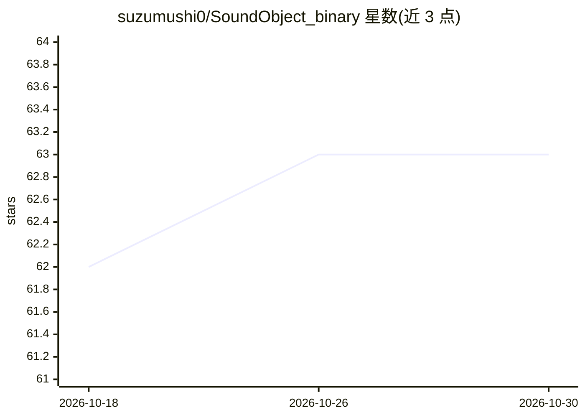

# suzumushi0/SoundObject_binary

⭐ 63 · 推送 2026-08-13 · [GitHub](https://github.com/suzumushi0/SoundObject_binary) · [官网](https://suzumushi0.hatenablog.com/entry/SOv1/SO_EN) · 个人维护

**VST 3 插件：单声道源生成 3D 定位双耳声**

面向数字音频工作站（DAW）用户的 VST 3 插件，输入单声道音源及其位置信息，生成具有三维定位感的双耳声，支持耳机与立体声扬声器两种 3D 声音输出。定位机制以简化刚体球散射滤波器加机器学习训练的耳介散射滤波器替代传统 HRIR 卷积，以降低计算量；通过混响室反射波实现前方距离感，对移动声源恒定添加多普勒效应。支持 44.1/48/96 kHz 采样率，运行环境为 64 位 Windows 11 与 macOS 10.14，以二进制形式分发。机器学习细节见外部文档。

## 筛选速览

| 维度 | 判定 | 备注 |
|---|---|---|
| AI 角色 | `ai-native` | 本体是模型或模型工具 |
| 许可风险 | `none` | — |
| 部署形态 | `None` |  |
| 模型依赖 | — | README 未给出锁定关系 |
| 硬件要求 | — | 无带数字的原话,不猜 |
| 安装摩擦 | `low` | 无编译、无系统依赖或容器化 |
| 成熟度 | — | 结构信号不足 |

## 能力要点

- 以球散射滤波器加机器学习耳介散射滤波器替代 HRIR 卷积
- 混响室反射波实现前方距离感
- 对移动声源恒定添加多普勒效应
- 支持耳机与立体声扬声器的 3D 声音、44.1/48/96 kHz 采样率

## 适用场景

- 在 DAW 中为单声道音源添加三维空间定位效果
- 用耳机或立体声扬声器进行沉浸式 3D 音频制作
- 为移动声源制作带多普勒效应的音效

## 场景标签

 · 领域:音频处理/3D 空间音频

## 证据(README 行号)

> L7: Conventional three-dimensional binaural sound processors implement sound localization with the convolution of an aco
> L23: 従来の 3 次元バイノーラルサウンドプロセッサーは，頭部による散乱を表す頭部インパルス応答 (Head-Related Impulse Response: HRIR) と音源の畳み込みによって，定位感を実現している．この畳み込みは

## 星数曲线

2026-10-18 62 → 2026-10-30 63（+1）

---
*卡片 v1 · prompt 1.4 · 生成 2026-10-24 · 置信度 high · 依据 README sha `f6e01f6a0759` · [字段定义](../../DATASET.md)*
