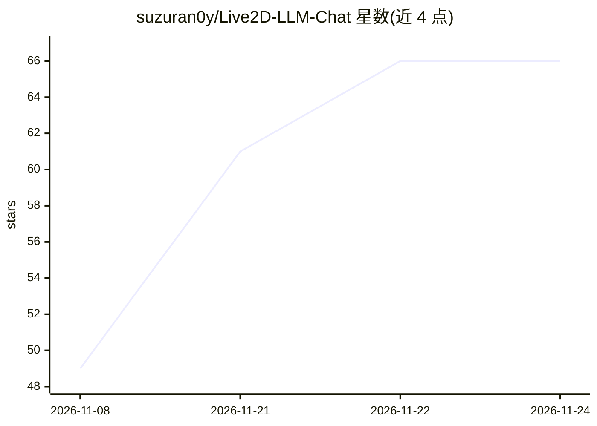

# suzuran0y/Live2D-LLM-Chat

⭐ 66 · JavaScript · Apache-2.0 · 推送 2026-11-03 · [GitHub](https://github.com/suzuran0y/Live2D-LLM-Chat) · 个人维护 · 中文 README

**Live2D 虚拟角色桌面应用：语音识别+LLM+语音合成实现本地对话**

基于 Electron 的 Windows 桌面应用，集成 Live2D 虚拟形象、SenseVoice 语音识别、本地 LLM（LM Studio 等环回兼容服务）与 TTS（默认 Windows 语音，可选 CosyVoice3），实现语音/文字对话、角色口型同步与凝视/眨眼/物理动画。支持 SQLite 会话持久化、上下文预算、自定义音色与历史导入。限制：仅接受本地模型服务，云模型与自动摘要未实现；非 Windows 平台未验证。桌面运行时与 Python 语音 worker 分离部署。

## 筛选速览

| 维度 | 判定 | 备注 |
|---|---|---|
| AI 角色 | `ai-native` | 本体是模型或模型工具 |
| 许可风险 | `permissive` | Apache-2.0 |
| 部署形态 | `desktop` | 安装包/桌面程序 |
| 模型依赖 | — | README 未给出锁定关系 |
| 硬件要求 | — | 无带数字的原话,不猜 |
| 安装摩擦 | `medium` | 含编译或系统依赖之一 |
| 成熟度 | `idea` | |

## 能力要点

- SenseVoice ASR + 本地 LLM + Windows 语音/CosyVoice3 TTS 的全链路语音对话
- Live2D 透明窗口形象：凝视、眨眼、呼吸、物理与实际播放驱动的口型同步
- SQLite 会话持久化、上下文预算与重启恢复
- 仅接受 localhost/127.0.0.1/::1 本地端点，无需云 API key

## 适用场景

- 与本地模型驱动的 Live2D 角色进行语音或文字对话
- 在离线/本地环境运行虚拟角色陪伴应用
- 用自定义音色参考让角色以特定嗓音回复

## 场景标签

`语音 Agent` · 领域:对话与助手

## 证据(README 行号)

> L16: **Live2D-LLM-Chat** is an AI interaction project that integrates **Live2D virtual avatars**, **Automatic Speech Rec
> L22: - **ASR**: SenseVoice transcribes recordings before sending them to the model.

## 星数曲线

2026-11-08 49 → 2026-11-24 66（+17）

---
*卡片 v1 · prompt 1.4 · 生成 2026-11-18 · 置信度 mid · 依据 README sha `9fe245d2abe0` · [字段定义](../../DATASET.md)*
