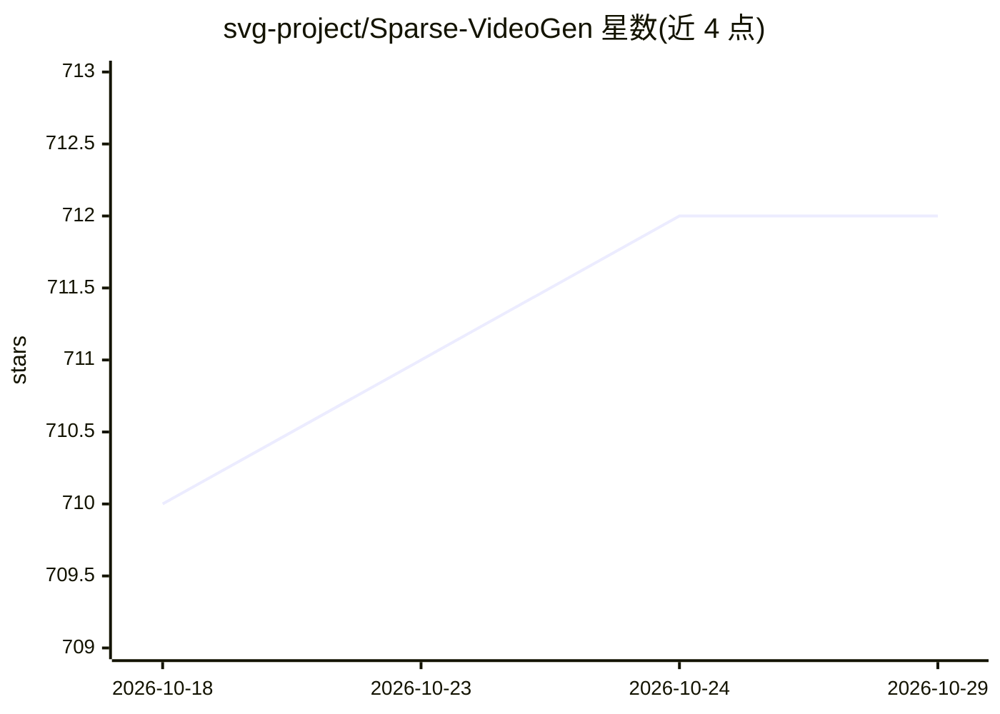

# svg-project/Sparse-VideoGen

⭐ 712 · Python · Apache-2.0 · 推送 2026-07-04 · [GitHub](https://github.com/svg-project/Sparse-VideoGen) · [官网](https://svg-project.github.io/) · 组织维护

**训练免费的稀疏注意力框架：加速视频扩散 Transformer 生成**

Sparse VideoGen 1/2/EAR 是三个 training-free 框架，利用 3D 全注意力中的固有稀疏性加速视频生成。SVG1 通过在线分析策略识别时空稀疏模式并以算法-系统协同设计实现端到端生成；SVG2 引入语义感知稀疏注意力、token 置换与 flash k-means 内核；SVG-EAR 用无参数质心补偿与误差感知路由恢复被跳过的注意力块。支持 HunyuanVideo、Wan 2.1（T2V/I2V）、CogVideoX v1.5、Cosmos 等模型的推理脚本，推荐 CUDA 12.4/12.8 + PyTorch 2.5.1/2.6.0，通过源码 clone 与 conda 环境安装。

## 筛选速览

| 维度 | 判定 | 备注 |
|---|---|---|
| AI 角色 | `ai-ecosystem` | LLM/agent 周边工具 |
| 许可风险 | `permissive` | Apache-2.0 |
| 部署形态 | `None` |  |
| 模型依赖 | — | README 未给出锁定关系 |
| 硬件要求 | — | 无带数字的原话,不猜 |
| 安装摩擦 | `medium` | 含编译或系统依赖之一 |
| 成熟度 | — | 结构信号不足 |

## 能力要点

- training-free，利用 3D 全注意力固有稀疏性加速视频生成
- 语义感知稀疏注意力 + token 置换 + flash k-means 内核
- 误差感知路由与无参数质心补偿（SVG-EAR）
- 支持 HunyuanVideo / Wan 2.1 / Cosmos 等模型的推理脚本

## 适用场景

- 在不重训模型的前提下加速视频扩散模型推理
- 对 Wan 2.1 / HunyuanVideo 做 T2V/I2V 生成并降低计算量
- 研究视频 DiT 中注意力稀疏性模式的科研工作

## 场景标签

`视频生成` `推理引擎` · 领域:内容生成

## 证据(README 行号)

> L17: Sparse VideoGen 1, 2, and EAR are **training-free frameworks** that leverage **inherent sparsity** in the 3D Full A
> L68: We support Text-to-Video and Image-to-Video inference of Wan 2.1 model. The running scripts are:

## 星数曲线

2026-10-18 710 → 2026-10-29 712（+2）

---
*卡片 v1 · prompt 1.4 · 生成 2026-10-21 · 置信度 high · 依据 README sha `9b70730ede32` · [字段定义](../../DATASET.md)*
