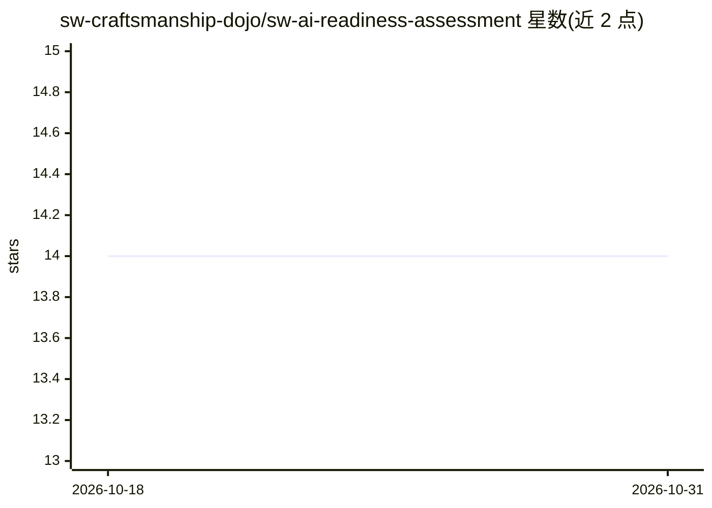

# sw-craftsmanship-dojo/sw-ai-readiness-assessment

⭐ 14 · AGPL-3.0 · 推送 2026-02-10 · [GitHub](https://github.com/sw-craftsmanship-dojo/sw-ai-readiness-assessment) · [官网](https://brix.consulting/free-ai-readiness-assessment/) · 组织维护

**面向软件组织的免费 AI 就绪度评估（问卷，产出差距分数）**

以网页问卷形式提供的免费组织评估：四个维度（Focus/Technical/Product/Feedback）共四题，约五分钟完成，输出一个 AI Readiness Gap 指标，衡量组织采纳 AI 的速度与吸收该加速的准备度之间的距离。内容引用 Stanford SWEPR、METR 2025 RCT、DORA 2024-2025、GitClear 2025 等研究，并提示 EU AI Act 对开发者能力证明的合规要求；评估结果差距较大时可申请 BriX Consulting 的免费咨询。AGPL-3.0 开源。

## 筛选速览

| 维度 | 判定 | 备注 |
|---|---|---|
| AI 角色 | `ai-knowledge` | 知识聚合/清单类 |
| 许可风险 | `viral` | AGPL-3.0 |
| 部署形态 | `None` |  |
| 模型依赖 | — | README 未给出锁定关系 |
| 硬件要求 | — | 无带数字的原话,不猜 |
| 安装摩擦 | `low` | 无编译、无系统依赖或容器化 |
| 成熟度 | — | 结构信号不足 |

## 能力要点

- 四题问卷，四维度（专注/技术/产品/反馈），产出单一 AI Readiness Gap 指标
- 综合 Stanford SWEPR、METR RCT、DORA、GitClear 四项研究
- 关联 EU AI Act 合规语境下的开发者能力证明
- AGPL-3.0 开源

## 适用场景

- 组织在引入 AI 编码工具前评估自身准备度
- 面向监管或董事会说明 AI 采纳风险前的自查
- 获得差距结果后寻求解读咨询

## 场景标签

 · 领域:软件工程/组织评估

## 证据(README 行号)

> L7: Click below 👇 to start your FREE AI-Readiness Assessment.
> L33: Four questions. Five minutes. One number that tells you where you stand.

## 星数曲线

2026-10-18 14 → 2026-10-31 14（+0）

---
*卡片 v1 · prompt 1.4 · 生成 2026-10-31 · 置信度 mid · 依据 README sha `f5897e73e7fe` · [字段定义](../../DATASET.md)*
