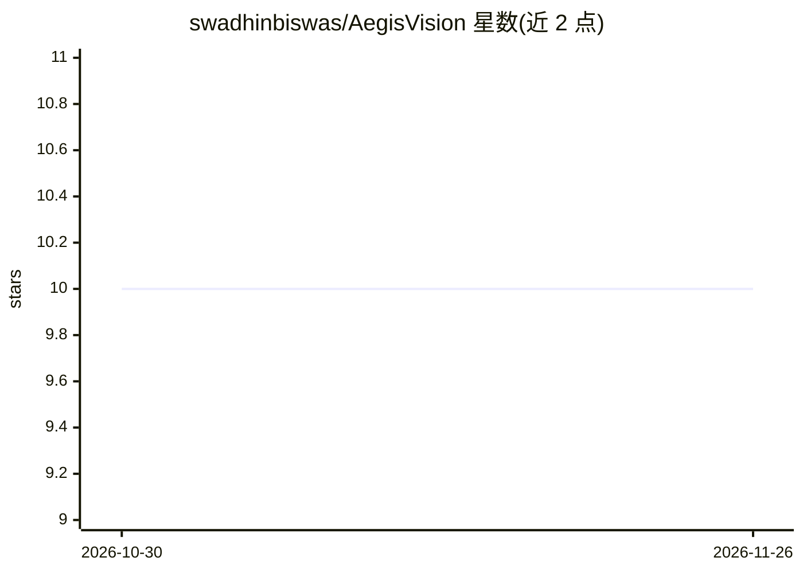

# swadhinbiswas/AegisVision

⭐ 10 · Python · CC0-1.0 · 推送 2026-08-08 · [GitHub](https://github.com/swadhinbiswas/AegisVision) · [官网](https://github.com/swadhinbiswas/AegisVision) · 个人维护

**多摄像头人脸识别与行为监控平台，含 AI copilot**

将 CCTV/网络摄像头/RTSP 流接入的监控平台：SCRFD+ArcFace（ONNX）实时人脸识别，dlib 作回退后端；含活体反欺骗评分、门禁与在场统计、生产力/疲劳行为分析、资产位移防盗记忆，告警经 WebSocket 推送并可接 Telegram/webhook。数据存于 SQLite+ChromaDB，前端为 FastAPI 托管的 SPA。Generative-AI copilot 可用自然语言查询实时数据库，未配置 API key 时使用规则回退。UNKNOWN 人脸默认不落盘。

## 筛选速览

| 维度 | 判定 | 备注 |
|---|---|---|
| AI 角色 | `ai-native` | 本体是模型或模型工具 |
| 许可风险 | `viral` | CC0-1.0 |
| 部署形态 | `self-host` | docker 或自建部署 |
| 模型依赖 | — | README 未给出锁定关系 |
| 硬件要求 | — | 无带数字的原话,不猜 |
| 安装摩擦 | `low` | 无编译、无系统依赖或容器化 |
| 成熟度 | — | 结构信号不足 |

## 能力要点

- SCRFD/ArcFace ONNX 实时识别，FACE_BACKEND=auto 自动回退 dlib
- 活体反欺骗门控（ANTI_SPOOF_THRESHOLD）与规则化告警升级
- 拖放文件夹即可注册人员，watchdog 同步 roster
- 自然语言 copilot 查询实时数据库，规则回退可用

## 适用场景

- 办公/校园/工地的多摄像头考勤与在场监控
- 识别陌生访客并推送实时告警
- 统计人员生产力、疲劳与手机分心时长
- 资产位移的防盗空间记忆与告警

## 场景标签

`人脸识别` `数据分析` · 领域:效率与自动化

## 证据(README 行号)

> L21: - **Recognize many people, in real time** — SCRFD/ArcFace via ONNX (lightweight, accurate) with an automatic dlib f
> L24: - **Track behavior** — gate in/out & live occupancy, active/idle-lazy/bunking/phone-distraction time, drowsiness & 

## 星数曲线

2026-10-30 10 → 2026-11-26 10（+0）

---
*卡片 v1 · prompt 1.4 · 生成 2026-11-19 · 置信度 high · 依据 README sha `0dc59bfe61bc` · [字段定义](../../DATASET.md)*
