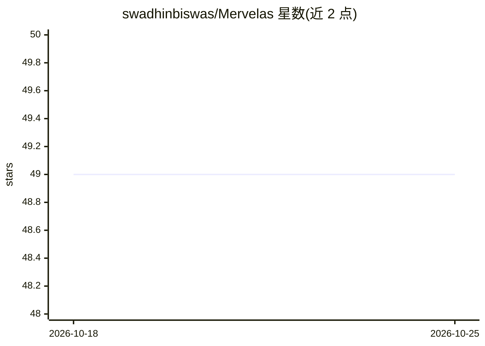

# swadhinbiswas/Mervelas

⭐ 49 · TypeScript · 推送 2026-04-03 · [GitHub](https://github.com/swadhinbiswas/Mervelas) · 个人维护

**本地优先的开源 AI 编码 CLI，支持多 LLM 提供商**

基于 Bun 构建并原生编译的终端 AI 编码助手，面向希望自主掌控工具链的开发者。支持 OpenAI、OpenRouter、NVIDIA NIM、Qwen、DeepSeek 及本地部署模型，通过 /config、/login 命令配置 API key，也可用环境变量做无头/CI 配置。会话历史以 JSONL 格式仅写入本地 ~/.mervelas/projects/，声明零遥测；支持创建本地自定义 Agent 与接入 MCP 服务器。目前处于活跃开发期，尚未发布到 NPM，需用 Bun 从源码本地编译运行。

## 筛选速览

| 维度 | 判定 | 备注 |
|---|---|---|
| AI 角色 | `ai-native` | 本体是模型或模型工具 |
| 许可风险 | `none` | — |
| 部署形态 | `None` |  |
| 模型依赖 | locked-api |  |
| 硬件要求 | — | 无带数字的原话,不猜 |
| 安装摩擦 | `low` | 无编译、无系统依赖或容器化 |
| 成熟度 | `idea` | |

## 能力要点

- 支持 OpenAI/OpenRouter/NVIDIA NIM/Qwen/DeepSeek 及本地模型
- 基于 Bun 原生编译，自定义 React Ink 抽象渲染
- 会话历史仅以 JSONL 存本地，声明零遥测
- 内置 /agents 自定义 Agent 与 /mcp 接入 MCP 服务器

## 适用场景

- 在终端里用自选 LLM 提供商做 AI 辅助编码
- CI/无头环境下通过环境变量配置运行
- 为不同项目创建并切换本地编码 Agent

## 场景标签

`编码 Agent` · 领域:编码与开发

## 证据(README 行号)

> L18: Mervelas is an independent, open-source AI coding CLI built from the ground up to guarantee freedom, zero telemetry
> L24: 1. **Provider Independence:** We break the chains. Mervelas fully supports OpenAI, OpenRouter, NVIDIA NIM, Qwen, De
> L62: Once running, simply execute `/config` or `/login` in the prompt to set up your LLM provider and paste your API key

## 星数曲线

2026-10-18 49 → 2026-10-25 49（+0）

---
*卡片 v1 · prompt 1.4 · 生成 2026-10-24 · 置信度 high · 依据 README sha `ee42f1ed7dd7` · [字段定义](../../DATASET.md)*
