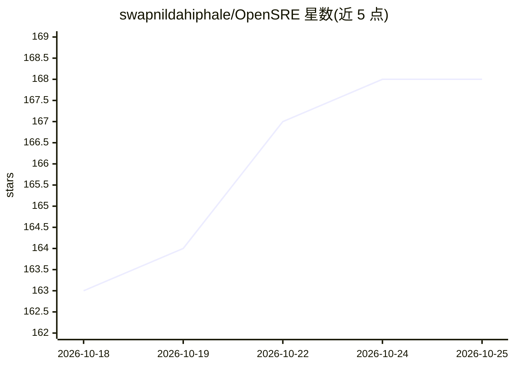

# swapnildahiphale/OpenSRE

⭐ 168 · Python · Apache-2.0 · 推送 2026-10-24 · [GitHub](https://github.com/swapnildahiphale/OpenSRE) · [官网](https://opensre.in) · 个人维护

**自托管 AI SRE 智能体：自动调查生产事故并记忆复盘**

开源的 AI SRE 平台，自动调查生产事故、定位根因并从每次调查中学习。核心机制：Neo4j 情景记忆（记录历史事故及修复方案，调查中经 memory-search 调出）、Neo4j 知识图谱（服务拓扑、依赖遍历、影响半径）与 51 个面向 Datadog、Grafana、PagerDuty、Elasticsearch、Kubernetes、AWS 等工具的生产技能。基于 Claude Agent SDK 编排，默认直连 Anthropic，可经 LiteLLM 代理接入其他提供商；提供 Web 控制台、Slack 与 Teams 集成、Entra SSO。Apache 2.0 许可，自托管运行依赖 Docker。注意 make dev 为本地开发模式，明文 HTTP 且无沙箱隔离，不用于生产暴露。

## 筛选速览

| 维度 | 判定 | 备注 |
|---|---|---|
| AI 角色 | `ai-native` | 本体是模型或模型工具 |
| 许可风险 | `permissive` | Apache-2.0 |
| 部署形态 | `None` |  |
| 模型依赖 | locked-api |  |
| 硬件要求 | — | 无带数字的原话,不猜 |
| 安装摩擦 | `low` | 无编译、无系统依赖或容器化 |
| 成熟度 | — | 结构信号不足 |

## 能力要点

- Neo4j 情景记忆：调查中调出历史相似事故的解决方案
- Neo4j 知识图谱提供服务拓扑与影响半径分析
- 51 个生产技能覆盖 Datadog/Grafana/PagerDuty/Elasticsearch/K8s/AWS 等
- Web 控制台、Slack/Teams 集成与 Entra SSO 登录

## 适用场景

- 生产事故发生时让 AI 智能体自动调查并给出根因
- 值班团队通过 Slack 或 Teams 直接触发事故调查
- 积累组织内事故处理经验供后续相似事件复用

## 场景标签

`知识图谱` `Agent 记忆` · 领域:Agent 开发

## 证据(README 行号)

> L14: OpenSRE is an open-source AI SRE agent that automatically investigates production incidents, finds root causes, and
> L162: - **Claude Agent SDK** — Agent orchestration (root investigator → specialist subagents)

## 星数曲线

2026-10-18 163 → 2026-10-25 168（+5）

---
*卡片 v1 · prompt 1.4 · 生成 2026-10-22 · 置信度 high · 依据 README sha `a18d6dabfbf5` · [字段定义](../../DATASET.md)*
