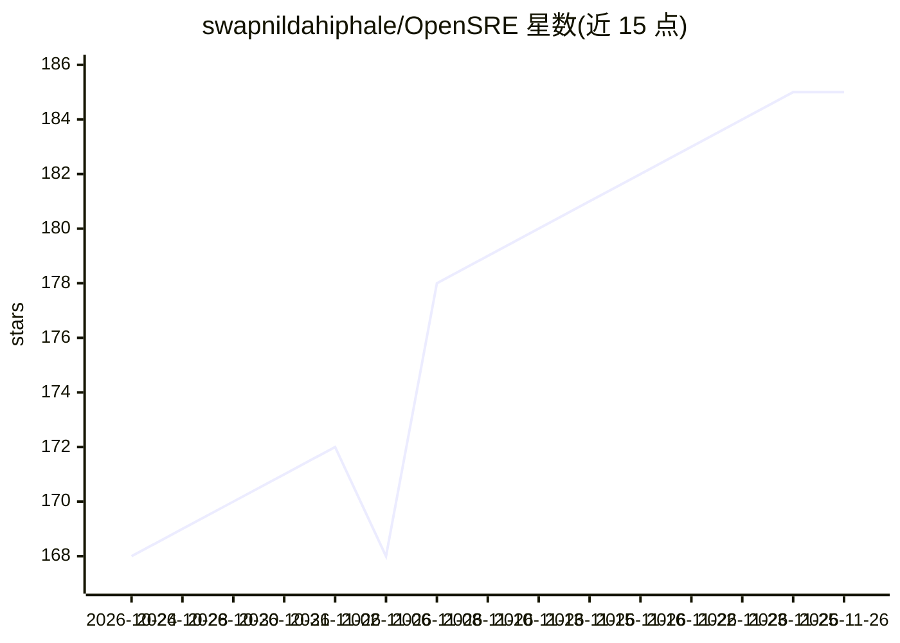

# swapnildahiphale/OpenSRE

⭐ 185 · Python · Apache-2.0 · 推送 2026-11-24 · [GitHub](https://github.com/swapnildahiphale/OpenSRE) · [官网](https://opensre.in) · 个人维护

**自托管 AI SRE 代理：自动调查生产事故并沉淀记忆**

开源 AI SRE 代理，自动调查生产事故、定位根因，并从每次调查中学习。核心机制包括情景记忆（记住过往事故与修复方案）、Neo4j 知识图谱（服务依赖与爆炸半径分析）以及 51 个生产技能，覆盖 Datadog、Grafana、PagerDuty、Elasticsearch、Kubernetes、AWS 等工具。默认直连 Anthropic，可经可选 LiteLLM 代理支持其他模型。通过 make dev 以 Docker 启动 Postgres、Neo4j、agent 与 Web 控制台，并支持 Slack/Teams 集成与 Entra SSO。本地开发模式为明文 HTTP、无沙箱隔离，仅限 localhost 使用。

## 筛选速览

| 维度 | 判定 | 备注 |
|---|---|---|
| AI 角色 | `ai-native` | 本体是模型或模型工具 |
| 许可风险 | `permissive` | Apache-2.0 |
| 部署形态 | `None` |  |
| 模型依赖 | locked-api |  |
| 硬件要求 | — | 无带数字的原话,不猜 |
| 安装摩擦 | `low` | 无编译、无系统依赖或容器化 |
| 成熟度 | — | 结构信号不足 |

## 能力要点

- 51 个生产技能接入 Datadog、Grafana、PagerDuty、K8s、AWS 等工具
- Neo4j 情景记忆在调查中检索过往解决方案
- Neo4j 知识图谱进行服务拓扑与爆炸半径分析
- Web 控制台、Slack/Teams 机器人与 Entra SSO 登录

## 适用场景

- 自动调查生产事故并生成根因分析
- 在值班时从 Slack/Teams 直接触发事故调查
- 让 agent 结合服务依赖图评估故障影响范围
- 用 EKS/Kind 上的故障注入测试做端到端演练

## 场景标签

`知识图谱` · 领域:知识与检索

## 证据(README 行号)

> L14: OpenSRE is an open-source AI SRE agent that automatically investigates production incidents, finds root causes, and
> L48: Requires **Docker Desktop** (or equivalent) running. `make dev` creates the external data volumes if they are missi

## 星数曲线

2026-10-24 168 → 2026-11-26 185（+17）

---
*卡片 v1 · prompt 1.4 · 生成 2026-11-26 · 置信度 high · 依据 README sha `586464145242` · [字段定义](../../DATASET.md)*
