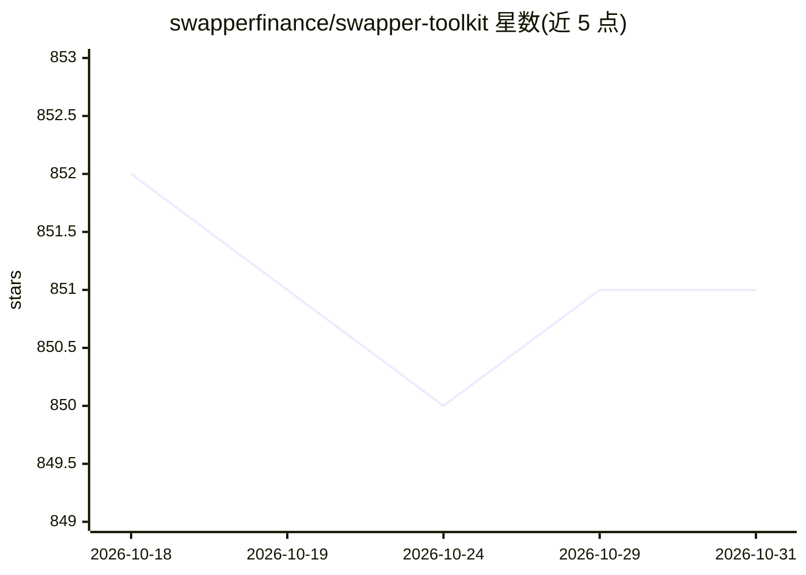

# swapperfinance/swapper-toolkit

⭐ 851 · MIT · 推送 2026-04-07 · [GitHub](https://github.com/swapperfinance/swapper-toolkit) · [官网](https://swapper.finance) · 组织维护

**供 AI agent 调用的 DeFi 支付技能包：充值、兑换与钱包管理**

面向 AI agent 与编码助手的技能（skills）工具包，遵循开放技能标准，可装入 Claude Code、Cursor、Windsurf、CrewAI、AutoGPT 等框架。提供三个技能：/swapper-deposit（充值与跨链桥接，支持法币入金 170+ 国家）、/swapper-trade（跨链兑换，标注 Coming Soon）、/swapper-wallet（智能钱包管理，标注 Coming Soon）。底层依赖 Chainlink CRE/CCIP 与 Mastercard；另提供 npm SDK 供应用嵌入充值流程。每笔交易需用户显式确认，私钥不被存储。

## 筛选速览

| 维度 | 判定 | 备注 |
|---|---|---|
| AI 角色 | `ai-ecosystem` | LLM/agent 周边工具 |
| 许可风险 | `permissive` | MIT |
| 部署形态 | `library` | 以包/库形式分发 |
| 模型依赖 | — | README 未给出锁定关系 |
| 硬件要求 | — | 无带数字的原话,不猜 |
| 安装摩擦 | `low` | 无编译、无系统依赖或容器化 |
| 成熟度 | — | 结构信号不足 |

## 能力要点

- 三个技能：充值/桥接、代币兑换、智能钱包管理
- 支持 Ethereum、Base、Solana 等 10 条链，CCIP 跨链
- 法币入金支持 Mastercard/Visa/Apple Pay/Google Pay（170+ 国家）
- 提供 @swapper-finance/deposit-sdk 供应用嵌入充值流程

## 适用场景

- 让编码助手或 agent 直接为钱包充值并注入 DeFi 协议
- agent 执行策略前自动补足钱包资金
- 在自有应用中嵌入带法币入金的充值弹窗

## 场景标签

 · 领域:区块链/DeFi 支付工具

## 证据(README 行号)

> L3: The payment layer for AI agents. Deposit funds, swap tokens, and manage wallets — directly from your AI agent or cod
> L5: Works with Claude Code, Cursor, Windsurf, OpenClaw, GitHub Copilot, CrewAI, AutoGPT, and any AI agent framework that

## 星数曲线

2026-10-18 852 → 2026-10-31 851（-1）

---
*卡片 v1 · prompt 1.4 · 生成 2026-10-21 · 置信度 high · 依据 README sha `b047cbfe5e69` · [字段定义](../../DATASET.md)*
