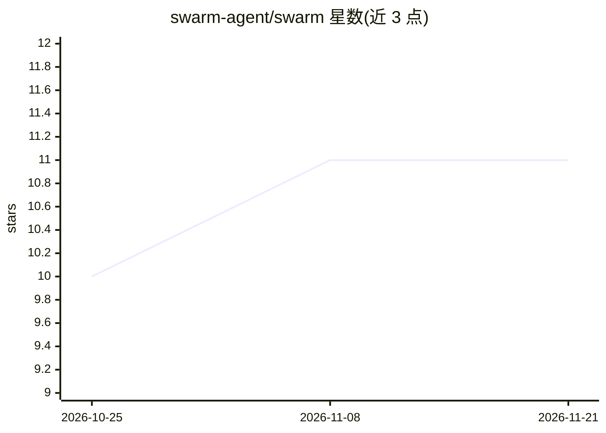

# swarm-agent/swarm

⭐ 11 · Go · Apache-2.0 · 推送 2026-11-07 · [GitHub](https://github.com/swarm-agent/swarm) · [官网](https://swarmagent.dev) · 组织维护

**Linux 自托管的 headless AI agent 平台，托管与调度多类 agent**

在 Linux PC 或服务器上自托管的 headless agent 平台：内置 coder、designer、finder、media 四类 agent，支持任务委托、自定义 worker、cron 定时任务、工作流（如 reviewer 步骤）、文件夹级环境与密钥代理、监控告警（webhook/Telegram）。通过 MCP 供 Claude Code/Codex/ChatGPT 驱动，或经 SDK、HTTP API、CLI（swarmctl）集成。默认无沙箱无权限提示，可选容器沙箱。注意：项目已于 2026 年 11 月停止维护，托管服务与安装源已下线，仅 Releases 与 Apache-2.0 代码保留。

## 筛选速览

| 维度 | 判定 | 备注 |
|---|---|---|
| AI 角色 | `ai-ecosystem` | LLM/agent 周边工具 |
| 许可风险 | `permissive` | Apache-2.0 |
| 部署形态 | `None` |  |
| 模型依赖 | — | README 未给出锁定关系 |
| 硬件要求 | — | 无带数字的原话,不猜 |
| 安装摩擦 | `low` | 无编译、无系统依赖或容器化 |
| 成熟度 | — | 结构信号不足 |

## 能力要点

- 通过 MCP 让外部 AI（Claude Code/Codex/ChatGPT）委派目标并拆分给 coder/finder/designer
- 支持定时任务、自动化工作流与跨机器 fleet（tailnet MCP）
- 环境机制：容器化文件夹环境，agent 只见密钥替身
- 提供 SDK、HTTP API、CLI 与 20+ MCP 工具（含成本与 token 报告）

## 适用场景

- 在后台并行运行多个 coding agent，合并前由我的 AI 审查变更
- 在自己的 Linux 机器上运行自托管 agent 集群
- 让 Claude Code/ChatGPT 通过 MCP 把工作委派给本地 agent

## 场景标签

`编码 Agent` `多智能体` `Agent 框架` · 领域:Agent 开发

## 证据(README 行号)

> L11: **Swarm is a headless AI agent platform you self-host on Linux. It runs coding, research, design and media agents, 
> L17: - **MCP tools** for your AI: Claude Code, Codex or ChatGPT.
> L63: - Run a self-hosted agent fleet on your own Linux machines. Commands and

## 星数曲线

2026-10-25 10 → 2026-11-21 11（+1）

---
*卡片 v1 · prompt 1.4 · 生成 2026-11-18 · 置信度 high · 依据 README sha `ec26209fa486` · [字段定义](../../DATASET.md)*
