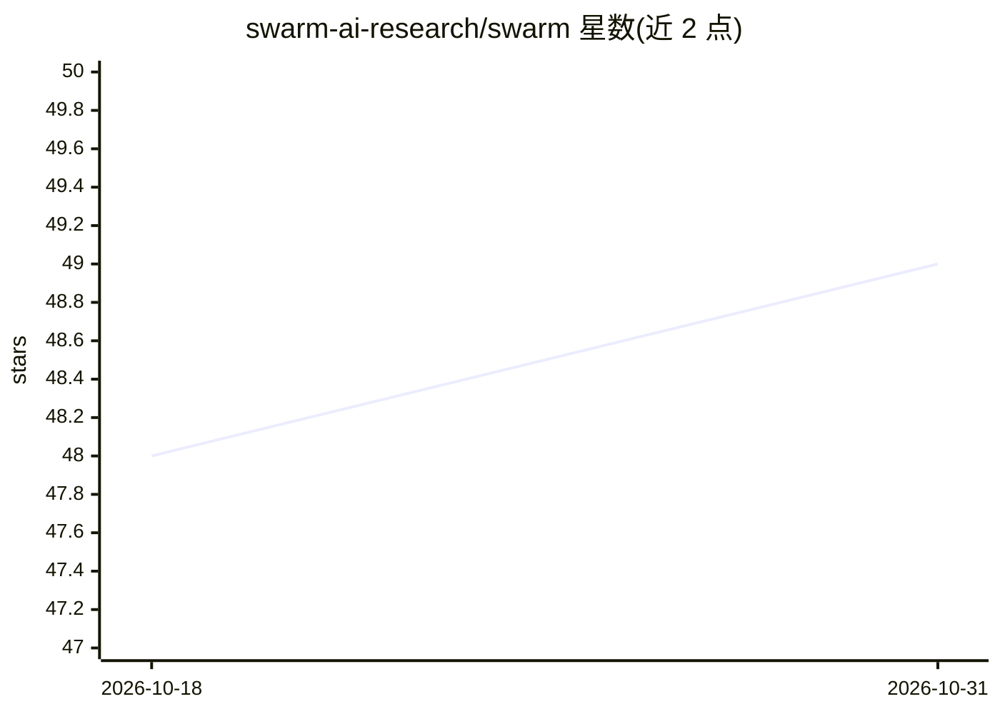

# swarm-ai-research/swarm

⭐ 49 · Python · MIT · 推送 2026-10-29 · [GitHub](https://github.com/swarm-ai-research/swarm) · [官网](https://www.swarm-ai.org/) · 组织维护

**多智能体系统涌现风险评测框架：测量交互层面的安全性**

面向 AI 安全研究的 Python 框架，用于测量仅在高密度多智能体交互中出现的涌现性失败。核心机制包括：软概率标签（交互携带有益结果概率 p）、四项关键指标（毒性率、质量差距、条件损失、不一致性）及幻觉差 Δ_illusion、27+ 个治理杠杆（审计、质押、熔断、共谋检测等）、多种智能体策略（诚实/投机/欺骗/对抗/LLM 等）与 8 种攻击向量的红队评估。提供 pip 安装、CLI、YAML 场景的可复现运行与 Colab 笔记本；多数示例无需 API key，LLM 智能体可选支持 9 个提供商。

## 筛选速览

| 维度 | 判定 | 备注 |
|---|---|---|
| AI 角色 | `ai-ecosystem` | LLM/agent 周边工具 |
| 许可风险 | `permissive` | MIT |
| 部署形态 | `library` | 以包/库形式分发 |
| 模型依赖 | local-ok | 支持本地模型 |
| 硬件要求 | — | 无带数字的原话,不猜 |
| 安装摩擦 | `low` | 无编译、无系统依赖或容器化 |
| 成熟度 | — | 结构信号不足 |

## 能力要点

- 交互级安全指标：毒性率、质量差距、条件损失、不一致性、幻觉差
- 27+ 治理杠杆与 9 种智能体策略的多智能体仿真
- 8 种攻击向量红队评估与自动评分
- YAML 场景 + 固定种子的可复现运行，多数示例无需 API key

## 适用场景

- 开展多智能体系统涌现失败模式的安全研究
- 部署前对治理机制进行对抗性压力测试
- 用可复现基准比较不同安全干预措施的效果
- 红队演练：协调式对抗攻击场景评估

## 场景标签

`多智能体` `模型评测` · 领域:Agent 开发

## 证据(README 行号)

> L12: **AGI-level risks don't require AGI-level agents.** SWARM is a research framework for measuring emergent failures t
> L25: - reproducible multi-agent safety benchmarks

## 星数曲线

2026-10-18 48 → 2026-10-31 49（+1）

---
*卡片 v1 · prompt 1.4 · 生成 2026-10-25 · 置信度 high · 依据 README sha `22974008c8f1` · [字段定义](../../DATASET.md)*
