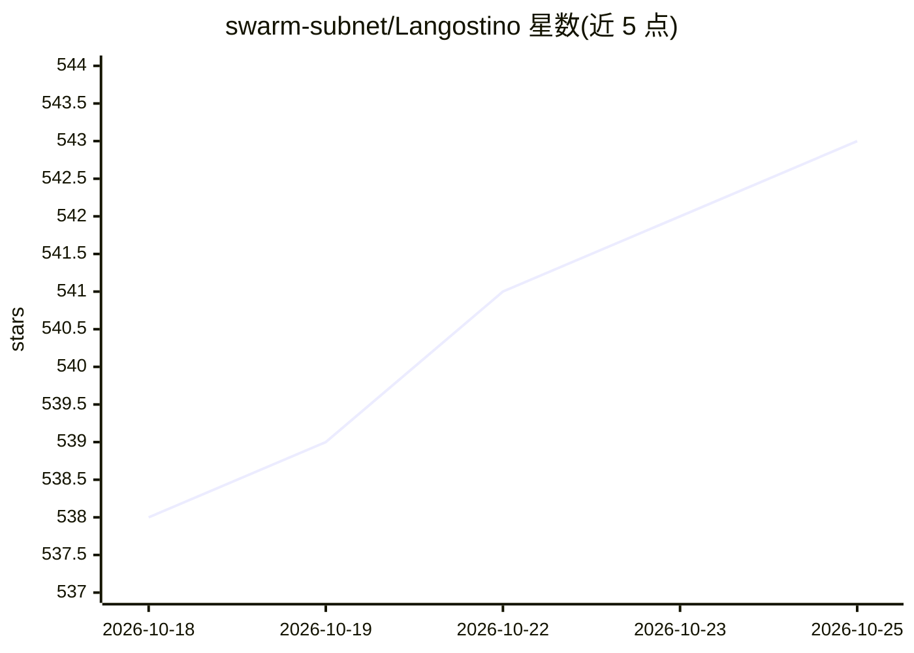

# swarm-subnet/Langostino

⭐ 543 · Python · MIT · 推送 2026-02-24 · [GitHub](https://github.com/swarm-subnet/Langostino) · [官网](https://swarm124.com/) · 组织维护

**开源自主无人机参考平台：AI 自动驾驶仪，从零组装到首飞**

基于 ROS2 与树莓派的开源自主飞行参考平台，面向希望理解、搭建并扩展真实无人机自主飞行的创客与开发者。提供从零件清单（BOM）、装配指南、INAV 飞控配置（PID 调参、MSP）到 Ubuntu + ROS2 Humble 安装的完整文档路径；软件侧包含 swarm_ai_integration 主 ROS2 包，构建技术栈涉及 Gym、PyBullet Drones 与 Bittensor。README 附安全警告：真实飞行器需遵守当地法规并使用保护与失效保护。

## 筛选速览

| 维度 | 判定 | 备注 |
|---|---|---|
| AI 角色 | `ai-native` | 本体是模型或模型工具 |
| 许可风险 | `permissive` | MIT |
| 部署形态 | `None` |  |
| 模型依赖 | — | README 未给出锁定关系 |
| 硬件要求 | — | 无带数字的原话,不猜 |
| 安装摩擦 | `low` | 无编译、无系统依赖或容器化 |
| 成熟度 | — | 结构信号不足 |

## 能力要点

- 完整的从零件到首飞的参考实现（装配指南、BOM、排障文档）
- ROS2 Humble on Raspberry Pi 的节点配置与命令文档
- INAV 飞控配置、PID 调参与 MSP 配置说明
- 提供离线地图瓦片服务器（Map Proxy）用于地面站

## 适用场景

- 从零组装一架可自主飞行的无人机
- 学习并扩展真实世界的无人机自主飞行软件
- 以该参考平台为起点做自己的无人机实验

## 场景标签

`强化学习` · 领域:训练与推理

## 证据(README 行号)

> L5:  Open-source AI autopilot for the real world: understand it, build it, and fly it.
> L85: * **A practical AI autopilot project** focused on flying in the real world (not a black box)
> L98: ROS Python Raspberry Pi INAV Gym PyBullet Drones Bittensor

## 星数曲线

2026-10-18 538 → 2026-10-25 543（+5）

---
*卡片 v1 · prompt 1.4 · 生成 2026-10-21 · 置信度 mid · 依据 README sha `6fc356552aef` · [字段定义](../../DATASET.md)*
