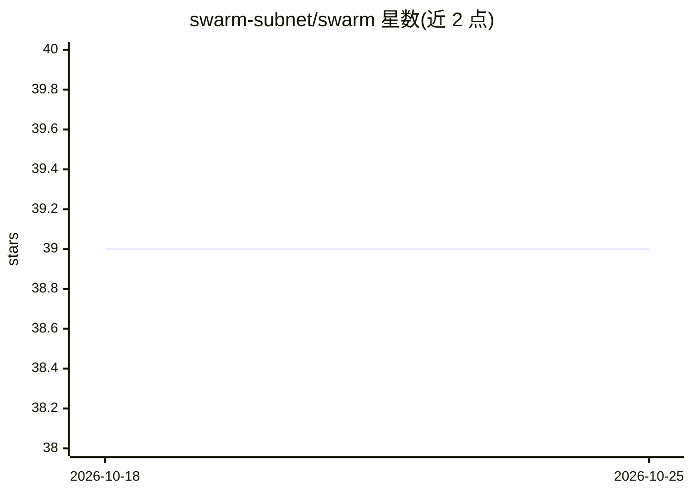

# swarm-subnet/swarm

⭐ 39 · Python · MIT · 推送 2026-10-22 · [GitHub](https://github.com/swarm-subnet/swarm) · [官网](https://swarm124.com/) · 组织维护

**开放无人机自主飞行竞技场：训练模型参赛并排名**

Bittensor Subnet 124 上的无人机导航基准与竞赛网络：参与者在仿真中训练以深度相机与飞行状态为输入、输出飞行指令的模型，提交后由验证者在每个 14 天周期生成的 1,000 个全新世界中评分，按成功(45%)、速度(45%)、安全(10%)计算 0-1 分并登上公开排行榜。设 5 个任务，奖励按 King of the Hill 机制由网络自动发放。提供 swarm CLI 本地打包、基准测试与可视化命令，本地使用与验证者相同的仿真器和评分路径；附开源实机 Langostino 的搭建指南，支持训练成果迁移到真实硬件。

## 筛选速览

| 维度 | 判定 | 备注 |
|---|---|---|
| AI 角色 | `ai-ecosystem` | LLM/agent 周边工具 |
| 许可风险 | `permissive` | MIT |
| 部署形态 | `None` |  |
| 模型依赖 | — | README 未给出锁定关系 |
| 硬件要求 | — | 无带数字的原话,不猜 |
| 安装摩擦 | `low` | 无编译、无系统依赖或容器化 |
| 成熟度 | — | 结构信号不足 |

## 能力要点

- 每 epoch 1,000 个新鲜世界，5 个任务，60 秒飞行，公开排行榜
- 深度相机+飞行状态输入，模型 50Hz 输出飞行指令，无地图无 GPS
- King of the Hill 奖励机制，奖励前五任冠军，由 Bittensor 网络自动发放
- swarm CLI 提供本地打包、基准评分与可视化，与验证者同一路径

## 适用场景

- 训练无人机导航模型并在公开排行榜上与其他模型竞技
- 在本地仿真环境中迭代对比模型表现后再提交
- 运行验证者节点参与网络评分
- 按开源指南搭建 Langostino 实机，把仿真训练的模型飞到真实硬件上

## 场景标签

`模型评测` · 领域:评测与运维

## 证据(README 行号)

> L21: **Swarm is the open arena that settles it.** Anyone can train a drone pilot, submit it, and watch it compete on a p
> L127: Everything happens from the terminal, with no dashboards to wrangle. Train, package, and score your model with a h

## 星数曲线

2026-10-18 39 → 2026-10-25 39（+0）

---
*卡片 v1 · prompt 1.4 · 生成 2026-10-25 · 置信度 high · 依据 README sha `7f4b14e6d256` · [字段定义](../../DATASET.md)*
