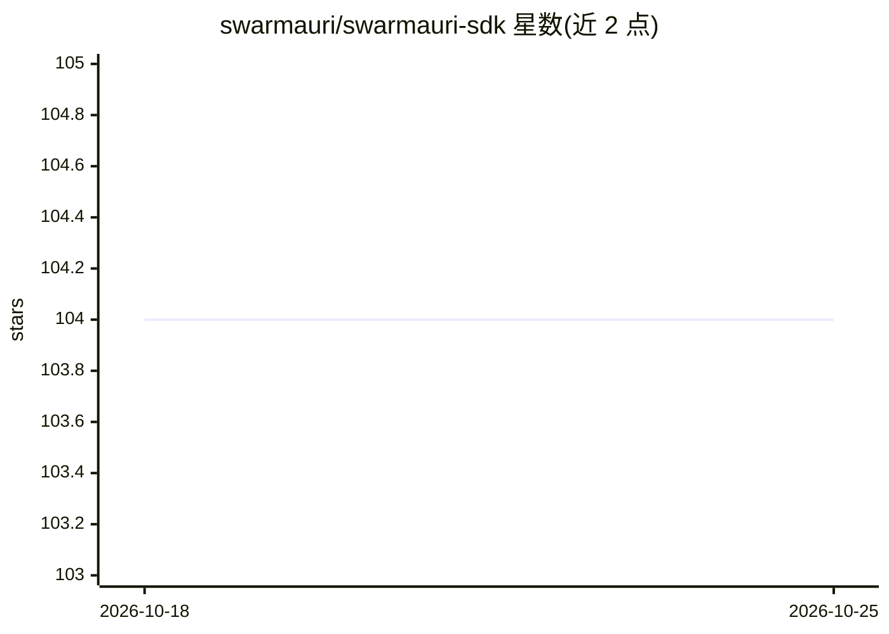

# swarmauri/swarmauri-sdk

⭐ 104 · Python · Apache-2.0 · 推送 2026-08-12 · [GitHub](https://github.com/swarmauri/swarmauri-sdk) · [官网](https://swarmauri.com) · 组织维护

**面向 AI agent 的模块化 Python SDK：可组合的组件与集成**

一个以命名空间包组织的 monorepo，将组件接口契约（swarmauri_core）与实现分离，通过 swarmauri_base 提供 Pydantic 基类、序列化与组件注册，swarmauri_standard 提供第一方标准组件，另有社区集成、插件、实验与标准包。组件族覆盖 agents、LLM、tools、parsers、embeddings、vector stores、签名、密钥、传输、中间件、计费适配器等，可按单一组件族独立安装（如 swarmauri_vectorstore_pinecone）。支持 Python 3.10-3.14，Apache 2.0 许可。

## 筛选速览

| 维度 | 判定 | 备注 |
|---|---|---|
| AI 角色 | `ai-ecosystem` | LLM/agent 周边工具 |
| 许可风险 | `permissive` | Apache-2.0 |
| 部署形态 | `library` | 以包/库形式分发 |
| 模型依赖 | — | README 未给出锁定关系 |
| 硬件要求 | — | 无带数字的原话,不猜 |
| 安装摩擦 | `low` | 无编译、无系统依赖或容器化 |
| 成熟度 | — | 结构信号不足 |

## 能力要点

- 命名空间包提供稳定导入，各包依赖独立、可单独安装
- 接口契约与实现分离的微内核式架构（core/base/standard 分层）
- 组件族覆盖 agents、LLM、embeddings、vector stores、签名、计费等
- 通过 entry points 支持插件注册与命名空间发现

## 适用场景

- 构建由 LLM、工具、向量库等可插拔组件组成的 agent 系统
- 组件作者基于统一接口契约开发并发布 provider 集成
- 按需安装单一组件族以缩小依赖面

## 场景标签

`Agent 框架` · 领域:Agent 开发

## 证据(README 行号)

> L18: Swarmauri is a composable intelligence infrastructure SDK for building typed, pluggable Python systems. The reposit
> L22: Swarmauri separates component contracts from implementations so applications can compose agents, tools, models, par
> L49: - Component families for agents, chains, conversations, documents, embeddings, LLMs, parsers, prompts, schema conve

## 星数曲线

2026-10-18 104 → 2026-10-25 104（+0）

---
*卡片 v1 · prompt 1.4 · 生成 2026-10-23 · 置信度 high · 依据 README sha `ad978c350fa5` · [字段定义](../../DATASET.md)*
