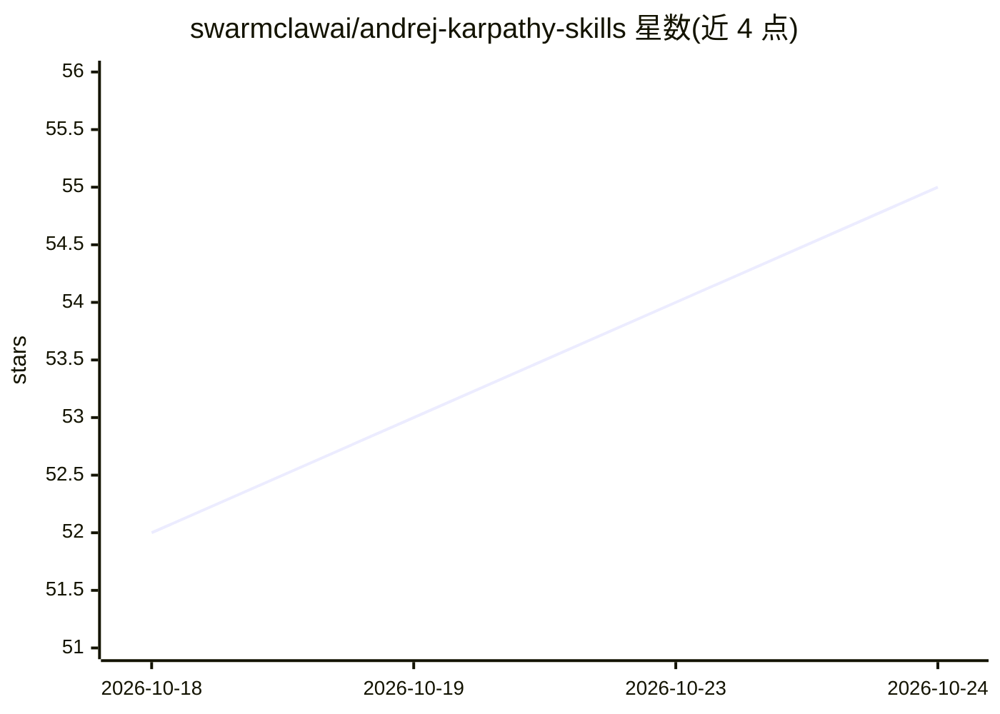

# swarmclawai/andrej-karpathy-skills

⭐ 56 · JavaScript · MIT · 推送 2026-05-11 · [GitHub](https://github.com/swarmclawai/andrej-karpathy-skills) · 组织维护 · 中文 README

**打包给各类编程 Agent 的 Karpathy 编码准则技能包**

以 skills/karpathy-guidelines/SKILL.md 为规范源，把 Andrej Karpathy 提出的四条编码准则（先思考、简洁优先、外科手术式修改、目标驱动执行）生成到各编程 Agent 的指令文件位置，覆盖 Codex、Claude Code、Cursor、Gemini CLI、Aider、Copilot 等约 40+ 目标。提供 npm/npx 安装器与 git clone 后 node 脚本两种安装方式，按 install/targets.json 将适配文件复制到各 Agent 期望路径，支持 --force 与 --global。内容定位为与项目自身指令合并而非替代，基于 forrestchang 原仓库，MIT 许可。

## 筛选速览

| 维度 | 判定 | 备注 |
|---|---|---|
| AI 角色 | `ai-ecosystem` | LLM/agent 周边工具 |
| 许可风险 | `permissive` | MIT |
| 部署形态 | `library` | 以包/库形式分发 |
| 模型依赖 | — | README 未给出锁定关系 |
| 硬件要求 | — | 无带数字的原话,不猜 |
| 安装摩擦 | `low` | 无编译、无系统依赖或容器化 |
| 成熟度 | — | 结构信号不足 |

## 能力要点

- 单一规范源 SKILL.md 生成 40+ Agent 适配文件
- npx/npm CLI 安装器按目标 Agent 复制适配文件
- 四条针对 LLM 编码失败模式的准则（先思考/简洁/外科手术式修改/目标驱动）
- 支持 --force 覆盖与 --global 用户级技能安装

## 适用场景

- 给自己的编程 Agent 统一注入 Karpathy 编码行为准则
- 在多个 Agent 工具间复用同一份指导文件
- 通过 Claude 插件市场分发该技能

## 场景标签

`提示工程` · 领域:Agent 开发

## 证据(README 行号)

> L5: The canonical source is `skills/karpathy-guidelines/SKILL.md`. Agent-specific files are generated under `adapters/` 
> L27: npx @swarmclawai/andrej-karpathy-skills --list
> L90: `codex`, `claude`, `cursor`, `goose`, `pi`, `gemini`, `opencode`, `aider`, `copilot`, `trae`, `claw`, `droid`, `kir

## 星数曲线

2026-10-18 52 → 2026-10-24 55（+3）

---
*卡片 v1 · prompt 1.4 · 生成 2026-10-24 · 置信度 high · 依据 README sha `f082367360b9` · [字段定义](../../DATASET.md)*
