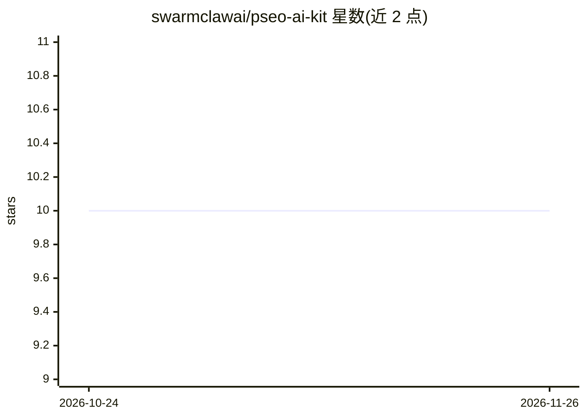

# swarmclawai/pseo-ai-kit

⭐ 10 · TypeScript · MIT · 推送 2026-04-28 · [GitHub](https://github.com/swarmclawai/pseo-ai-kit) · 组织维护

**AI 应用的程序化 SEO 脚手架工具包**

面向运营 pSEO（程序化 SEO）站点的开发者提供的 Next.js 15 开源脚手架：包含 Zod 校验的类型化内容数据层、默认调用 Claude Haiku 的 LLM 内容生成器（按关键词逐页生成）、关键词规划工作流（导入/去重/聚类/增量生成缓存）、sitemap/robots/JSON-LD 等 SEO 要件、内链图谱构建与导出、SEO 校验器以及 Vercel 部署预检。CLI 所有命令支持 --json 输出与稳定退出码，并附 help-agents 命令目录，供编码类 agent 驱动。

## 筛选速览

| 维度 | 判定 | 备注 |
|---|---|---|
| AI 角色 | `ai-ecosystem` | LLM/agent 周边工具 |
| 许可风险 | `permissive` | MIT |
| 部署形态 | `library` | 以包/库形式分发 |
| 模型依赖 | local-ok | 支持本地模型 |
| 硬件要求 | — | 无带数字的原话,不猜 |
| 安装摩擦 | `low` | 无编译、无系统依赖或容器化 |
| 成熟度 | — | 结构信号不足 |

## 能力要点

- LLM 内容生成器按关键词生成页面，默认调用 Claude Haiku
- 内链图谱按关键词重叠连接页面，可导出 graph.svg
- 校验器捕捉重复 slug、薄内容、图孤儿页等部署阻塞项
- CLI 全命令支持 --json、稳定退出码与非交互模式，供 agent 调用

## 适用场景

- 用关键词清单批量生成 pSEO 页面并部署到 Vercel
- 让 Claude Code、Cursor 等编码 agent 通过 JSON CLI 驱动建站流程
- 为已有 Next.js 站点补充 JSON-LD、内链图谱与 SEO 校验

## 场景标签

`AI 写作` · 领域:内容生成

## 证据(README 行号)

> L3: > Programmatic SEO starter for AI apps. Next.js 15 + Vercel + LLM content generator + sitemap / JSON-LD / internal-l
> L81: The default generator uses Anthropic's Claude Haiku for cost. The `ContentClient` interface is one method (`generat
> L107: Every swarmclawai CLI follows the same agent conventions so Claude Code, Cursor, Cline, Aider, Codex et al can dri

## 星数曲线

2026-10-24 10 → 2026-11-26 10（+0）

---
*卡片 v1 · prompt 1.4 · 生成 2026-11-19 · 置信度 high · 依据 README sha `bc33e64d0d4b` · [字段定义](../../DATASET.md)*
