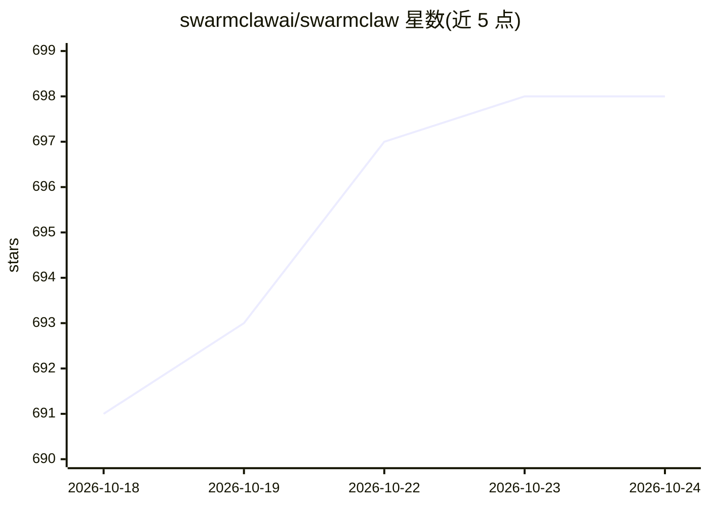

# swarmclawai/swarmclaw

⭐ 698 · TypeScript · MIT · 推送 2026-06-30 · [GitHub](https://github.com/swarmclawai/swarmclaw) · [官网](https://www.swarmclaw.ai) · 组织维护

**自托管多智能体运行时与编排框架，支持 23+ LLM 提供商**

开源、自托管的 AI agent 运行时与多智能体框架：运行自主 agent、agent 群与编排器，提供持久化 agent 记忆、MCP 工具、运行时技能、定时任务、委派与对话转技能学习；兼容 OpenClaw 网关及 Claude、GPT、Gemini、OpenRouter、Ollama 等 23+ 提供商与多种 CLI 后端。提供桌面安装包（macOS/Windows/Linux）、npm 全局安装、源码运行与 Docker Compose 四种部署方式，运行后经浏览器访问 localhost:3456。要求 Node.js 22.6+ 与 npm 10+，Docker Desktop 为可选（用于沙箱浏览器执行）。

## 筛选速览

| 维度 | 判定 | 备注 |
|---|---|---|
| AI 角色 | `ai-ecosystem` | LLM/agent 周边工具 |
| 许可风险 | `permissive` | MIT |
| 部署形态 | `desktop` | 安装包/桌面程序 |
| 模型依赖 | local-ok | 支持本地模型 |
| 硬件要求 | — | 无带数字的原话,不猜 |
| 安装摩擦 | `low` | 无编译、无系统依赖或容器化 |
| 成熟度 | — | 结构信号不足 |

## 能力要点

- 持久化 agent 记忆与对话转技能学习
- 23+ LLM 提供商接入及多种 CLI 后端委派
- 定时任务、委派与多 agent 编排（org chart 可视化）
- macOS/Windows/Linux 桌面安装包与 Docker 部署

## 适用场景

- 搭建自托管的多 agent 协作与编排平台
- 通过定时任务和委派运行自主 agent 工作流
- 统一管理多家 LLM 提供商与 CLI 后端的 agent 环境

## 场景标签

`Agent 框架` `多智能体` `Agent 记忆` · 领域:Agent 开发

## 证据(README 行号)

> L9:  The self-hosted AI agent runtime and multi-agent framework for autonomous agents. Open-source agent swarms with dur
> L13: SwarmClaw is an open-source, self-hosted AI agent runtime and multi-agent framework. Run autonomous AI agents, agen

## 星数曲线

2026-10-18 691 → 2026-10-24 698（+7）

---
*卡片 v1 · prompt 1.4 · 生成 2026-10-21 · 置信度 high · 依据 README sha `9575fb0dc378` · [字段定义](../../DATASET.md)*
