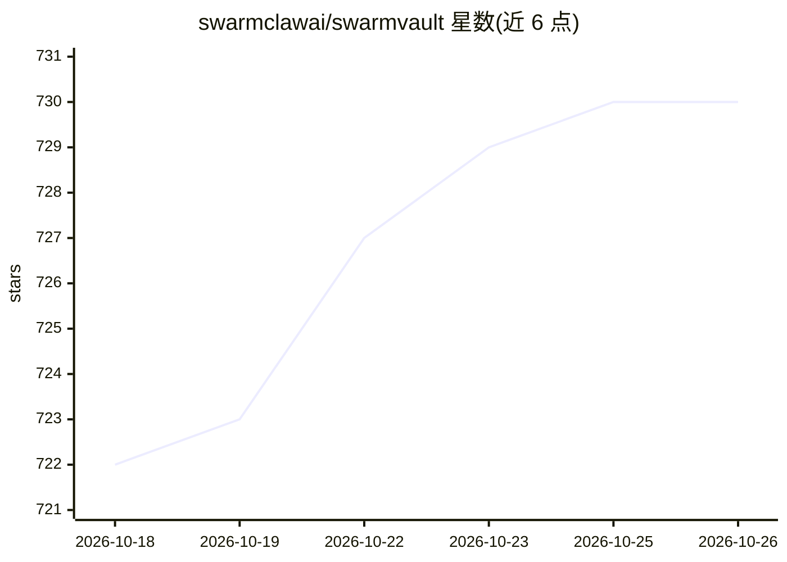

# swarmclawai/swarmvault

⭐ 730 · TypeScript · MIT · 推送 2026-06-30 · [GitHub](https://github.com/swarmclawai/swarmvault) · [官网](https://www.swarmvault.ai) · 组织维护 · 中文 README

**本地优先的 LLM Wiki 工具链：把文档/代码构建为知识图谱与 RAG 库**

将文档、代码、转录、笔记和 URL 摄取为持久化的 markdown wiki 与本地知识图谱，供人查询和交付给 AI agent 使用。采用 Karpathy 描述的三层架构（raw 源 / wiki / schema），提供矛盾检测、审批队列、SQLite FTS + 嵌入混合搜索、MCP server、agent 上下文包与 Neo4j 导出。内置 heuristic 提供者可完全离线运行，无 API key 要求；可选接入 Ollama 本地模型或 OpenAI/Anthropic 等云服务。以 npm CLI 与桌面应用形式提供。

## 筛选速览

| 维度 | 判定 | 备注 |
|---|---|---|
| AI 角色 | `ai-ecosystem` | LLM/agent 周边工具 |
| 许可风险 | `permissive` | MIT |
| 部署形态 | `self-host` | docker 或自建部署 |
| 模型依赖 | local-ok | 支持本地模型 |
| 硬件要求 | — | 无带数字的原话,不猜 |
| 安装摩擦 | `low` | 无编译、无系统依赖或容器化 |
| 成熟度 | — | 结构信号不足 |

## 能力要点

- 三层架构实现：raw 不可变源 / LLM 与人共写 wiki / 可演化 schema
- 内置 heuristic 提供者，离线无 API key 即可运行
- SQLite 全文 + 嵌入混合搜索，边标注 extracted/inferred/ambiguous 并做矛盾检测
- MCP server、agent 上下文包、任务台账与 Neo4j/graph 导出

## 适用场景

- 把个人文档、代码库、转录整理成可持续积累的知识库
- 为 Claude Code / Codex 等 agent 提供持久化记忆
- 研究深挖或代码文档场景下构建可审查的知识图谱

## 场景标签

`知识库管理` `知识图谱` `RAG` `Agent 记忆` · 领域:Agent 开发

## 证据(README 行号)

> L11: **The local-first LLM Wiki, knowledge graph builder, and RAG knowledge base for AI agents.** SwarmVault turns docs,
> L76: **"Is it just for personal use?"** — Git-backed workflows (`--commit`), watch mode with git hooks, scheduled automa
> L78: **"Do I need API keys?"** — No. The built-in `heuristic` provider is fully offline. For sharper extraction, pair wi

## 星数曲线

2026-10-18 722 → 2026-10-26 730（+8）

---
*卡片 v1 · prompt 1.4 · 生成 2026-10-21 · 置信度 mid · 依据 README sha `523b8e686ef5` · [字段定义](../../DATASET.md)*
