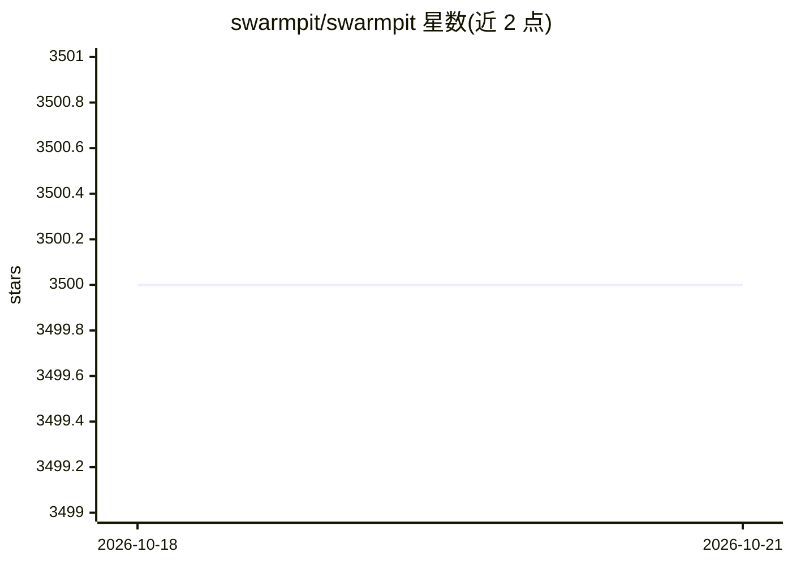

# swarmpit/swarmpit

⭐ 3,500 · Clojure · EPL-1.0 · 推送 2026-10-13 · [GitHub](https://github.com/swarmpit/swarmpit) · [官网](https://swarmpit.io) · 组织维护

**自托管的 Docker Swarm 管理控制台，附带 MCP 服务器供 LLM 客户端调用**

Swarmpit 是一个面向 Docker Swarm 集群的自托管 Web 管理界面，用于管理 stacks、services、secrets、volumes、networks 等，可关联 Docker Hub 或私有 registry 部署镜像，并支持团队共享控制台。所有 UI 功能同时通过 REST API（Swagger 文档）暴露。AI 相关部分：提供独立 MCP 服务器（swarmpit/mcp），使 Claude Code、opencode 等 MCP 兼容客户端可驱动部署操作，API token 保留在本地服务器不进入 LLM 上下文。通过 Docker 镜像安装器或 compose 文件部署，唯一依赖是已初始化 Swarm 的 Docker（1.13+），支持 x86 与 ARM 的 Linux 主机。

## 筛选速览

| 维度 | 判定 | 备注 |
|---|---|---|
| AI 角色 | `ai-enhanced` | 去掉 AI 部分产品仍成立 |
| 许可风险 | `viral` | EPL-1.0 |
| 部署形态 | `self-host` | docker 或自建部署 |
| 模型依赖 | — | README 未给出锁定关系 |
| 硬件要求 | — | 无带数字的原话,不猜 |
| 安装摩擦 | `low` | 无编译、无系统依赖或容器化 |
| 成熟度 | — | 结构信号不足 |

## 能力要点

- Docker Swarm 集群的 stacks/services/secrets/volumes/networks 统一管理界面
- 全部 UI 功能经 REST API（/api-docs Swagger 文档）暴露
- MCP 服务器使 MCP 兼容客户端（Claude Code、opencode 等）可驱动管理操作
- 完全自托管，不收集用户指标数据；支持 x86 与 ARM Linux 主机

## 适用场景

- 用 Web 界面管理 Docker Swarm 集群并部署私有仓库镜像
- 通过 MCP 客户端自动化 Swarm 部署与运维
- 团队共享同一套安全的集群管理控制台

## 场景标签

 · 领域:容器编排/DevOps 工具

## 证据(README 行号)

> L12: Swarmpit provides simple and easy to use interface for your Docker Swarm cluster. You can manage your stacks, servi
> L14: Everything the UI does is also exposed via a REST API (Swagger docs at `/api-docs` on any running instance) and, fo
> L85: Manage Swarmpit from any MCP-compatible client (Claude Code, opencode, etc.) via swarmpit/mcp. The server runs loca

## 星数曲线

2026-10-18 3,500 → 2026-10-21 3,500（+0）

---
*卡片 v1 · prompt 1.4 · 生成 2026-10-20 · 置信度 high · 依据 README sha `1c5dc424a956` · [字段定义](../../DATASET.md)*
