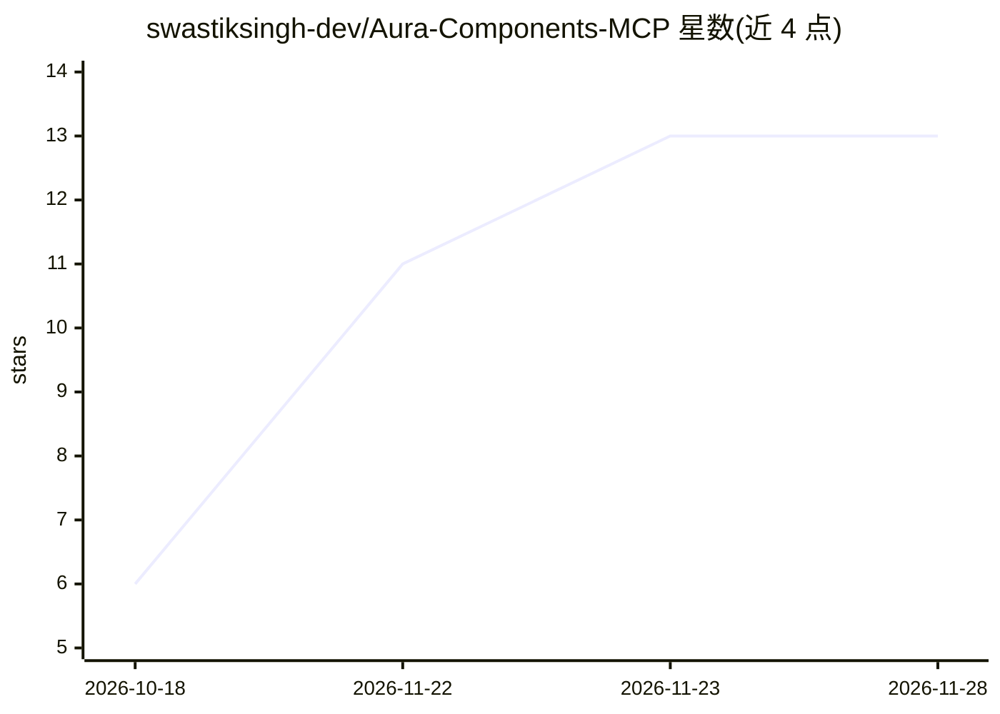

# swastiksingh-dev/Aura-Components-MCP

⭐ 13 · JavaScript · MIT · 推送 2026-11-24 · [GitHub](https://github.com/swastiksingh-dev/Aura-Components-MCP) · [官网](https://aura-mcp-web.vercel.app/) · 个人维护

**面向 agent 的 Aura 公共目录 MCP 服务器：检索组件/技能/资产/设计系统**

以 stdio 形式运行的 MCP 服务器，将 aura.build 公共目录（2,495 个免费组件、192 个技能、30,688 个资产、725 个设计系统）暴露为 35 个工具，供各类 MCP 客户端中的 agent 调用；覆盖搜索、取全文、安装指引、页面脚手架、Awwwards 获奖情报等。零 npm 依赖，需 Node 22+；部分获奖功能的无浏览器回退可用，实时抓取需 Chrome。与官方 OAuth 授权的 Aura MCP 定位互补，专注免登录的公共目录部分。

## 筛选速览

| 维度 | 判定 | 备注 |
|---|---|---|
| AI 角色 | `ai-ecosystem` | LLM/agent 周边工具 |
| 许可风险 | `permissive` | MIT |
| 部署形态 | `library` | 以包/库形式分发 |
| 模型依赖 | — | README 未给出锁定关系 |
| 硬件要求 | — | 无带数字的原话,不猜 |
| 安装摩擦 | `medium` | 含编译或系统依赖之一 |
| 成熟度 | — | 结构信号不足 |

## 能力要点

- 35 个工具经 stdio 暴露 4 类目录资源与 6 个获奖情报工具
- 无 OAuth、无账号、无 API key，零 npm 依赖
- aura_scaffold_page 一轮生成 tokens + 系统 + 依赖排序的 markup
- 基于文件 JSON 索引的获奖语料（原子写入、断点续传、约 1 req/s 限速抓取）

## 适用场景

- 让 Claude Code 等 agent 直接检索并安装 Aura 免费组件
- 一句话生成落地页的 starter kit（组件+设计系统+资产）
- 为 agent 安装 SKILL.md 技能文件以学习 GSAP/Tailwind v4 等
- 对照 Awwwards 获奖站点做设计蓝图与视觉审计

## 场景标签

`语义搜索` · 领域:知识与检索

## 证据(README 行号)

> L3:  FREE MCP SERVER · STDIO · ZERO DEPS · MIT
> L48: - 35 tools over stdio (29 catalogue + 6 award-intelligence), one bundle, 60-second LRU cache (300 keys) with reques
> L80: Then register it in your client. Full per-client steps live in SETUP.md — Claude Code, Cursor, Codex, Windsurf, Ope

## 星数曲线

2026-10-18 6 → 2026-11-28 13（+7）

---
*卡片 v1 · prompt 1.4 · 生成 2026-11-22 · 置信度 high · 依据 README sha `a53914ce5779` · [字段定义](../../DATASET.md)*
