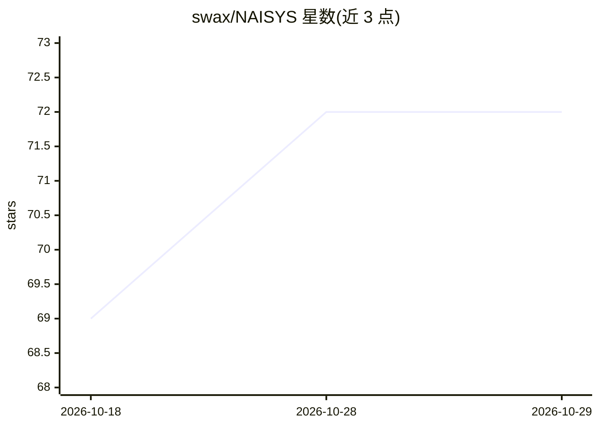

# swax/NAISYS

⭐ 72 · TypeScript · MIT · 推送 2026-10-28 · [GitHub](https://github.com/swax/NAISYS) · [官网](https://naisys.org/) · 个人维护

**自托管的『人+AI agent』共享集群：汇总机器、模型账号与工作**

NAISYS 是一套自托管系统，供一个团队把各自的机器（笔记本、GPU 主机、Windows 桌面、VM）、模型账号和工作汇集成一个由人类与 AI agent 共同组成的共享组织。本机启动集成服务器后通过浏览器 UI 创建 agent、邀请成员、添加主机、分配权限与查看控制台。Agent 可在集群任意主机运行或固定到特定机器，支持 shell、无头浏览器、桌面 computer use、图像生成等工具，提供按 agent 的花费限制与成本图表，并带可选的 ERP 订单/任务管理。由 naisys（agent 运行器）、hub（中心服务器）、supervisor（Web UI）、erp 四个 npm 包组成。需 Node.js 22+ 与受支持的 shell（bash/PowerShell/zsh 等），浏览器与桌面控制功能需额外可选依赖。

## 筛选速览

| 维度 | 判定 | 备注 |
|---|---|---|
| AI 角色 | `ai-ecosystem` | LLM/agent 周边工具 |
| 许可风险 | `permissive` | MIT |
| 部署形态 | `library` | 以包/库形式分发 |
| 模型依赖 | locked-api |  |
| 硬件要求 | — | 无带数字的原话,不猜 |
| 安装摩擦 | `low` | 无编译、无系统依赖或容器化 |
| 成熟度 | `idea` | |

## 能力要点

- 多机池化：桌面、笔记本、VM、GPU 主机统一接入，agent 可固定到特定主机运行
- 统一管理人类用户与 LLM-backed agent：权限、API key、邀请成员
- 支持 OpenAI、Anthropic、Google、OpenRouter、Grok 与本地 LLM 多种模型栈
- 提供 shell、无头浏览器、桌面 computer use、agent 间邮件与 agent-facing REST API 工具
- 按 agent 花费限制、滚动窗口、模型定价与成本图表

## 适用场景

- 团队把闲置机器与模型账号汇总成一个共享的 agent 运行集群
- 把 agent 固定到带 GPU、浏览器或桌面会话的机器上执行任务
- 通过浏览器实时查看 agent 控制台、运行日志并控制成本

## 场景标签

`GUI 自动化` `图像生成` `Agent 框架` · 领域:Agent 开发

## 证据(README 行号)

> L5: NAISYS is a self-hosted system for a group of people to pool machines, model accounts, and work into one shared orga
> L43: - **Use any model stack** - OpenAI, Anthropic, Google, OpenRouter, Grok, and local LLMs
> L51: - `naisys` — the agent runner

## 星数曲线

2026-10-18 69 → 2026-10-29 72（+3）

---
*卡片 v1 · prompt 1.4 · 生成 2026-10-24 · 置信度 high · 依据 README sha `4f00210fe660` · [字段定义](../../DATASET.md)*
