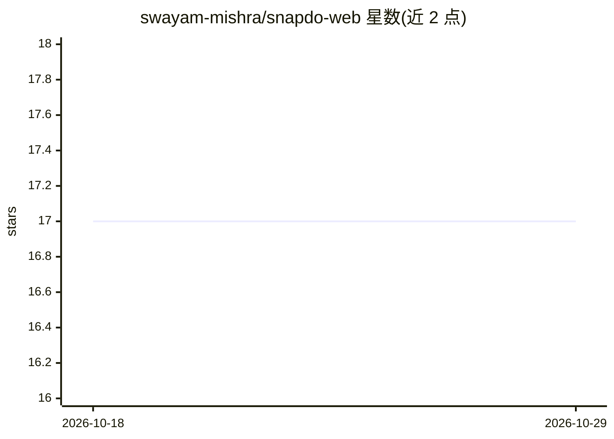

# swayam-mishra/snapdo-web

⭐ 17 · TypeScript · 推送 2026-05-25 · [GitHub](https://github.com/swayam-mishra/snapdo-web) · [官网](https://chat-2-cash.replit.app) · 个人维护

**面向印度小商户的 WhatsApp 订单转 GST 发票 Web 前端**

Snapdo 的 Web 前端（React + Vite + Tailwind CSS 4），面向 kirana 店、经销商和订餐服务等印度小商户：用户粘贴 WhatsApp 聊天记录，后端读取消息（含 Hinglish、语音笔记、非正式简写）抽取订单结构并生成 GST 合规发票。前端使用 Clerk 做认证、React Router 7 路由，通过环境变量配置 API 地址与 Clerk key 后 npm run dev 启动。AI 处理逻辑不在本仓库内。

## 筛选速览

| 维度 | 判定 | 备注 |
|---|---|---|
| AI 角色 | `ai-native` | 本体是模型或模型工具 |
| 许可风险 | `none` | — |
| 部署形态 | `library` | 以包/库形式分发 |
| 模型依赖 | — | README 未给出锁定关系 |
| 硬件要求 | — | 无带数字的原话,不猜 |
| 安装摩擦 | `low` | 无编译、无系统依赖或容器化 |
| 成熟度 | — | 结构信号不足 |

## 能力要点

- React + Vite 前端，粘贴 WhatsApp 聊天触发订单抽取与发票生成
- Clerk 认证与带 token 的 API 调用 hook（useApi）
- 本地运行需配置 VITE_API_BASE_URL 与 VITE_CLERK_PUBLISHABLE_KEY 环境变量

## 适用场景

- 印度小商户把 WhatsApp 订单聊天转成结构化订单和 GST 发票
- 作为 Snapdo 产品的 Web 界面本地开发与调试

## 场景标签

 · 领域:金融科技/小商户工具

## 证据(README 行号)

> L9: Indian businesses take hundreds of orders a day over WhatsApp — in Hinglish, voice notes, informal shorthand. Snapdo
> L3: Turn WhatsApp order chaos into structured orders and GST invoices. Built for kiranas, distributors, and tiffin servi

## 星数曲线

2026-10-18 17 → 2026-10-29 17（+0）

---
*卡片 v1 · prompt 1.4 · 生成 2026-10-29 · 置信度 mid · 依据 README sha `f9e5a2010fa7` · [字段定义](../../DATASET.md)*
