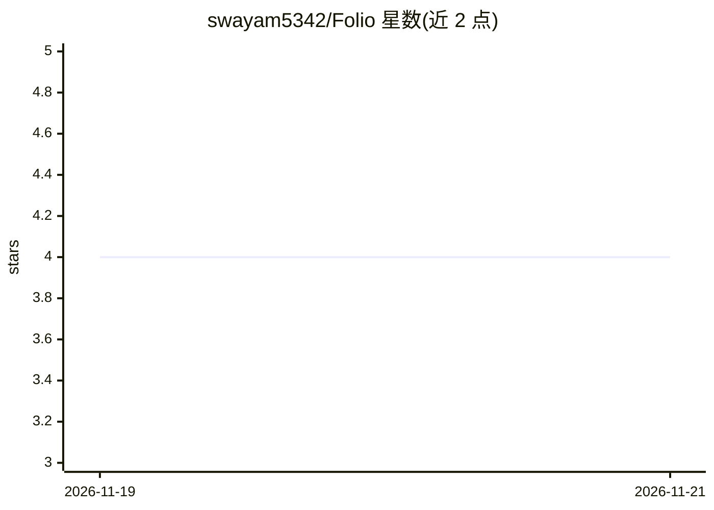

# swayam5342/Folio

⭐ 4 · TypeScript · 推送 2026-11-18 · [GitHub](https://github.com/swayam5342/Folio) · [官网](https://github.swayam.li/Folio/) · 个人维护

**面向个人文档问答的 RAG 应用，回答逐条引用到页码**

Folio 是一个 NotebookLM 风格的全栈文档问答应用：后端 FastAPI + Postgres/pgvector，前端 React，LLM 使用 Groq，Docker Compose 一键启动。支持 PDF、Word、PPT、Markdown 等来源，流程为解析分块→本地嵌入→混合检索（向量+关键词+RRF）→本地交叉编码器重排→置信度门控→流式生成，每条声明带引用并可跳转到原文高亮。附带评测工具（Hit@1/MRR 等指标）、测验/闪卡等学习工具、账户体系与提示注入防护；无文本层页面使用本地 OCR。

## 筛选速览

| 维度 | 判定 | 备注 |
|---|---|---|
| AI 角色 | `ai-native` | 本体是模型或模型工具 |
| 许可风险 | `none` | — |
| 部署形态 | `self-host` | docker 或自建部署 |
| 模型依赖 | locked-api |  |
| 硬件要求 | `cpu-ok` | |
| 安装摩擦 | `low` | 无编译、无系统依赖或容器化 |
| 成熟度 | — | 结构信号不足 |

## 能力要点

- 每条回答声明带页码引用，点击定位原文并高亮
- 混合检索：pgvector 向量 + 关键词 + 本地交叉编码器重排与置信度门控
- 内置评测工具与报告（50 题、含不可答问题的拒绝率）
- 提示注入隔离、PII 掩码、OCR 扫描页处理

## 适用场景

- 对自己的 PDF 论文或教材提问并核验出处
- 从课程资料生成带引用的测验和闪卡
- 搭建可自评检索质量的自托管文档问答服务

## 场景标签

`文档问答` `模型评测` · 领域:评测与运维

## 证据(README 行号)

> L7: `Folio` is a NotebookLM-style app for asking questions about your own documents: PDFs, Word files, PowerPoint decks,
> L27: |**Hybrid retrieval**|Vector plus keyword search, follow-up rewriting and a local cross-encoder reranker, with sect
> L78: ## Evaluation

## 星数曲线

2026-11-19 4 → 2026-11-21 4（+0）

---
*卡片 v1 · prompt 1.4 · 生成 2026-11-21 · 置信度 high · 依据 README sha `75dee059118e` · [字段定义](../../DATASET.md)*
