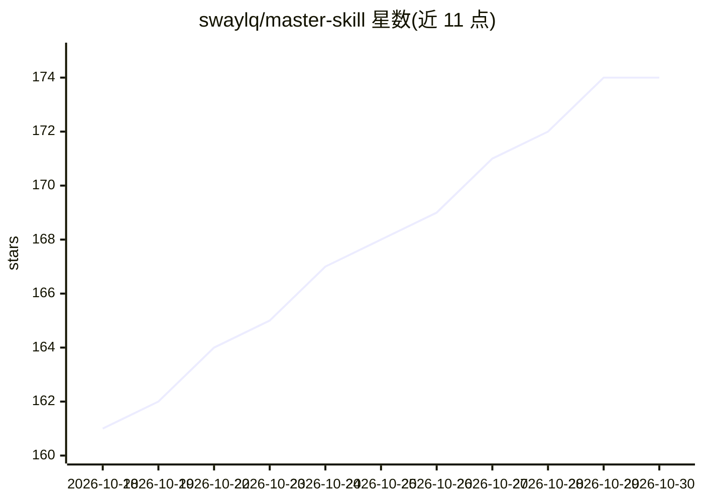

# swaylq/master-skill

⭐ 174 · Shell · MIT · 推送 2026-09-06 · [GitHub](https://github.com/swaylq/master-skill) · [官网](https://master-skill.org) · 个人维护 · 中文 README

**输入行业自动蒸馏出行业资深专家 agent skill 的元技能**

面向 Claude Code / OpenClaw / Codex / Hermes 等 agent 宿主的元 skill：输入细分行业后，经六路并行调研（行业大佬/工具地图/工作流/知识正典/信息源/术语标准）在 30-60 分钟内生成一个 {行业}-master skill 目录，内含 SKILL.md、人物 sub-skill 与纯 bash 命令套件。生成结果经 16 道质检与 validation gate 门控验收，仓库附 72 个已蒸馏行业样本。以 git clone 方式安装到宿主 skill 目录，Python + Shell 实现，MIT 许可，v1.1 仍在快速迭代。

## 筛选速览

| 维度 | 判定 | 备注 |
|---|---|---|
| AI 角色 | `ai-ecosystem` | LLM/agent 周边工具 |
| 许可风险 | `permissive` | MIT |
| 部署形态 | `library` | 以包/库形式分发 |
| 模型依赖 | — | README 未给出锁定关系 |
| 硬件要求 | — | 无带数字的原话,不猜 |
| 安装摩擦 | `low` | 无编译、无系统依赖或容器化 |
| 成熟度 | `idea` | |

## 能力要点

- 六路并行调研生成行业认知操作系统（心智模型/决策规则/工作流/工具栈）
- 每个生成的 skill 自带纯 bash cli 命令套件（零外部依赖）
- 16 道自动检验 + validation gate 验收，来源按一手/二手分类过滤
- 已蒸馏 72 个行业样本，附可追溯调研笔记

## 适用场景

- 为自己的行业定制一个资深专家 agent skill
- 让 AI agent 获得特定行业的判断框架与工作流
- 离线运行行业决策树与研究协议 bash 脚本

## 场景标签

`提示工程` · 领域:Agent 开发

## 证据(README 行号)

> L22: 告诉它你做哪个细分行业，
> L173: git clone https://github.com/swaylq/master-skill.git ~/.claude/skills/master-skill
> L184: |🟣 Claude Code|`~/.claude/skills/master-skill`|

## 星数曲线

2026-10-18 161 → 2026-10-30 174（+13）

---
*卡片 v1 · prompt 1.4 · 生成 2026-10-22 · 置信度 mid · 依据 README sha `c53323ae3370` · [字段定义](../../DATASET.md)*
