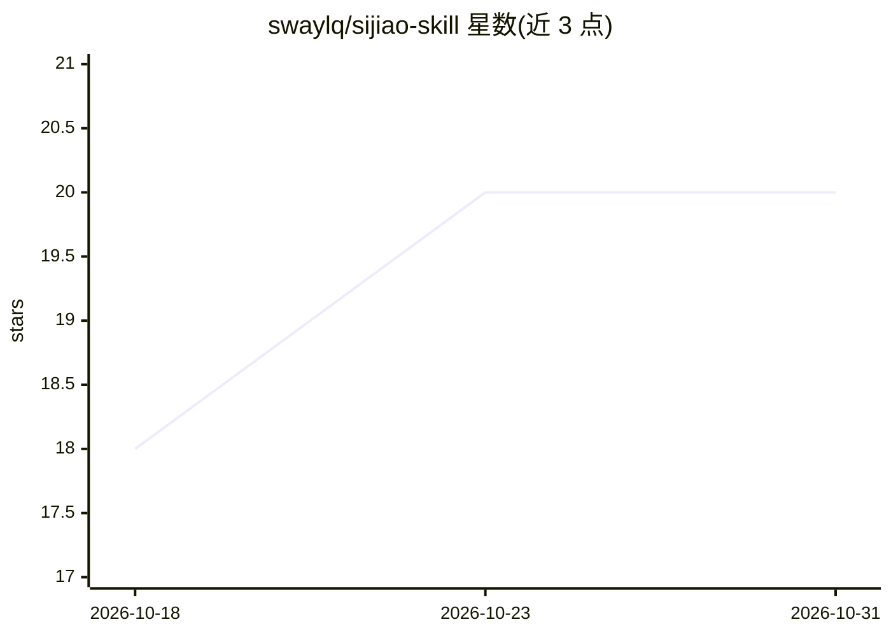

# swaylq/sijiao-skill

⭐ 20 · Python · MIT · 推送 2026-08-28 · [GitHub](https://github.com/swaylq/sijiao-skill) · [官网](https://swaylq.github.io/sijiao-skill/) · 个人维护 · 中文 README

**元 skill：输入想学的技能，蒸馏出带你从 0 学会的有状态私教**

面向 Claude Code 等 agent host 的元 skill（SKILL.md 格式），git clone 安装到 skills 目录后，用户对 agent 说「学 XXX」，触发 8 路并行调研并按学习科学（Dreyfus 分段、Bloom 分类、间隔重复 SM-2、刻意练习）蒸馏出自包含三层目录：curriculum 课程层、SKILL.md 教学层、learner-state.json 学习档案层。生成的私教 skill 支持读档续学、出题批改、增量刷新。内置纯标准库零依赖的工具引擎（35 个测试）与 6 个端到端样本（共 79 模块），路线图中的质检自动化与 PyPI 发布尚未完成（v0.1）。天花板自我限定在「胜任」级别。

## 筛选速览

| 维度 | 判定 | 备注 |
|---|---|---|
| AI 角色 | `ai-ecosystem` | LLM/agent 周边工具 |
| 许可风险 | `permissive` | MIT |
| 部署形态 | `library` | 以包/库形式分发 |
| 模型依赖 | — | README 未给出锁定关系 |
| 硬件要求 | — | 无带数字的原话,不猜 |
| 安装摩擦 | `low` | 无编译、无系统依赖或容器化 |
| 成熟度 | `idea` | |

## 能力要点

- 8 路并行调研按学习科学蒸馏出三层私教 skill（课程/教学/档案）
- learner-state.json 记录进度、错题与 SM-2 间隔重复排程，支持读档续学
- 工具引擎纯 Python 标准库零依赖，35 个测试，先修图拓扑校验
- 提供 6 个端到端样本（rust/线性代数/英语阅读/减肥/皮肤管理/健身，共 79 模块）

## 适用场景

- 让 Claude Code 等 agent 变成某技能的私教，从 0 带我学到胜任
- 跨设备/多次会话续学同一技能，自动安排间隔复习
- 为自己或团队批量生成结构化学习路径 skill

## 场景标签

`提示工程` · 领域:Agent 开发

## 证据(README 行号)

> L3: ### 输入任何想学的技能，蒸馏出一个**带你从 0 学会它**的有状态私教
> L143: 它先跟你确认 5 件事（技能、现有水平、目标、每周时间、locale），然后启动 **8 路并行调研** → 按学习科学蒸馏 → 生成三层私教目录。30-60 分钟后你拿到一个 `{技能}-learn`，装到任意 agent 立

## 星数曲线

2026-10-18 18 → 2026-10-31 20（+2）

---
*卡片 v1 · prompt 1.4 · 生成 2026-10-28 · 置信度 mid · 依据 README sha `303f4d8332dc` · [字段定义](../../DATASET.md)*
