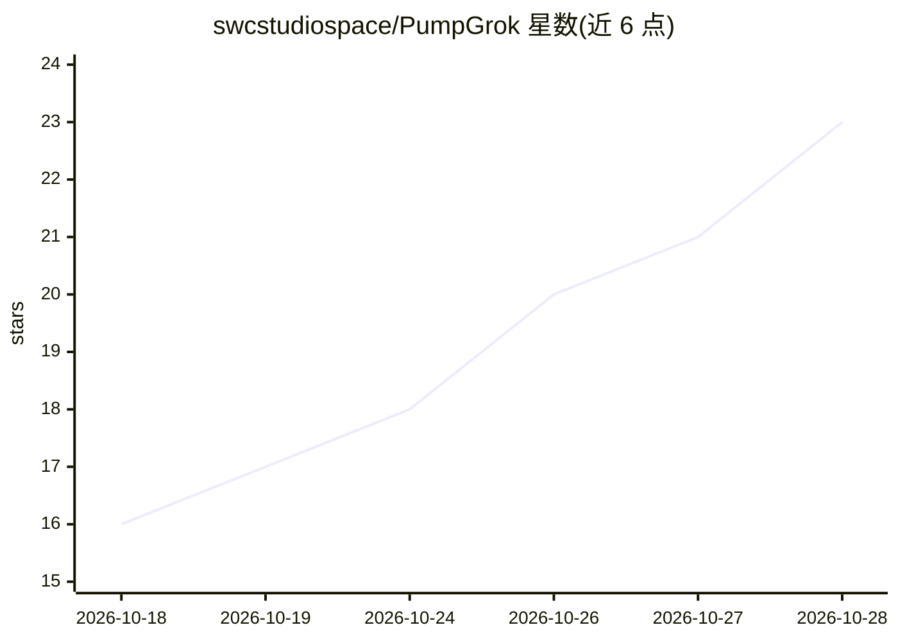

# swcstudiospace/PumpGrok

⭐ 23 · Python · AGPL-3.0 · 推送 2026-10-27 · [GitHub](https://github.com/swcstudiospace/PumpGrok) · 组织维护

**Solana memecoin 研究用十席位 agent 指令与技能包**

面向 Grok Bot、Cursor、Claude Code、Grok Build 等宿主 agent 运行时的加载包：含十个专员席位定义（CHIEF/SCOUT/RISK 等）、35 个 SKILL.md 技能、常驻安全守则与只读 Python CLI（Jupiter 报价、链上权限、优先费、票据、模拟成交记录）。私钥不进入系统，仅人工批准的票据可发送；CLI 的 paper buy/sell 在 Phase 4 验证前返回 unavailable。默认 research 模式，无实盘层级，不附带策略，Python 3.12 + uv 安装。

## 筛选速览

| 维度 | 判定 | 备注 |
|---|---|---|
| AI 角色 | `ai-ecosystem` | LLM/agent 周边工具 |
| 许可风险 | `viral` | AGPL-3.0 |
| 部署形态 | `None` |  |
| 模型依赖 | — | README 未给出锁定关系 |
| 硬件要求 | — | 无带数字的原话,不猜 |
| 安装摩擦 | `low` | 无编译、无系统依赖或容器化 |
| 成熟度 | — | 结构信号不足 |

## 能力要点

- 十席位 + 35 技能 + RISK 否决/人工审批/单次发送的守则
- 只读 CLI：Jupiter 报价、mint/freeze 权限、优先费、票据、模拟成交
- 无 API key、无私钥、无私钥签名；依赖经 uv.lock 锁定
- 为 Grok Bot/Claude Code/Cursor/Grok Build 提供插件清单

## 适用场景

- 在宿主 agent 运行时中搭建只读型 memecoin 研究席位
- 以票据流程记录并审批研究/模拟操作
- 审计 Jupiter 路由、持币集中度等链上数据

## 场景标签

 · 领域:加密货币/agent 指令工程

## 证据(README 行号)

> L5: PumpGrok is a ten-seat Solana memecoin trading desk packaged as agent instructions, 35 skills, a hard security const
> L22: - A host that can load `agents/`, `skills/`, and `rules/` (Grok Bot, Cursor, Claude Code, or Grok Build)

## 星数曲线

2026-10-18 16 → 2026-10-28 23（+7）

---
*卡片 v1 · prompt 1.4 · 生成 2026-10-28 · 置信度 high · 依据 README sha `b9d0c3b74c91` · [字段定义](../../DATASET.md)*
