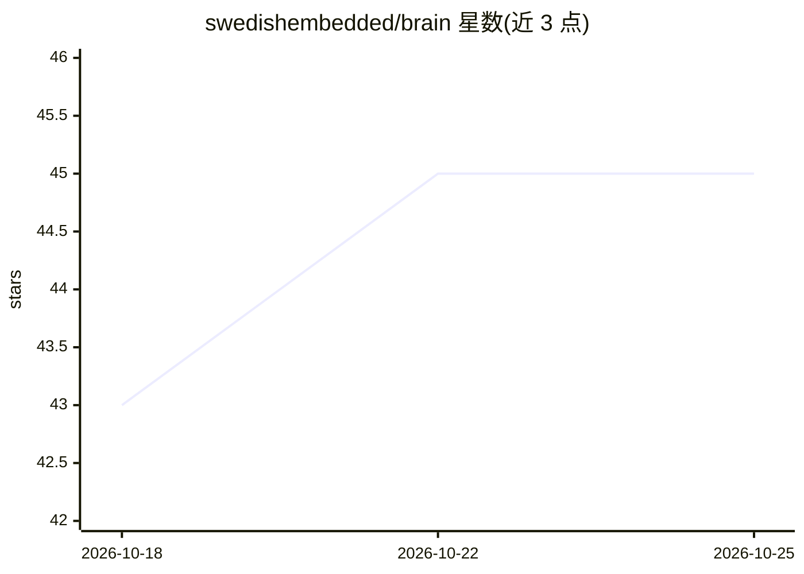

# swedishembedded/brain

⭐ 45 · Rust · Apache-2.0 · 推送 2026-10-25 · [GitHub](https://github.com/swedishembedded/brain) · [官网](https://swedishembedded.com/products/brain) · 组织维护

**Rust 单程序实现模型训练与推理，服务 OpenAI 兼容 API**

用 Rust 编写的模型运行与训练平台：一个程序完成模型下载、推理、LoRA 微调、从零训练、量化与对外服务（OpenAI/Anthropic/OpenRouter API、D-Bus、Rust SDK）。不依赖 Python 与 PyTorch，支持 NVIDIA/AMD/Intel/Apple GPU（wgpu/vulkan/cuda 后端）、纯 CPU、Intel NPU（经 ONNX+OpenVINO）与浏览器。模型目录覆盖文本、视觉、图文、图像视频生成、语音、预测与世界模型。由 Swedish Embedded AB 维护，Apache-2.0 许可。

## 筛选速览

| 维度 | 判定 | 备注 |
|---|---|---|
| AI 角色 | `ai-ecosystem` | LLM/agent 周边工具 |
| 许可风险 | `permissive` | Apache-2.0 |
| 部署形态 | `None` |  |
| 模型依赖 | — | README 未给出锁定关系 |
| 硬件要求 | — | 无带数字的原话,不猜 |
| 安装摩擦 | `medium` | 含编译或系统依赖之一 |
| 成熟度 | — | 结构信号不足 |

## 能力要点

- 单一 Rust 程序完成训练、微调、量化、推理与 API 服务，无需 Python/PyTorch
- 四种编译后端（wgpu/vulkan/cuda/cpu）共享同一内核，可用 --device/--backend 切换
- 提供 OpenAI/Anthropic/OpenRouter 兼容 API、D-Bus 与 Rust SDK 接入
- 导入模型逐步对照参考实现验证，训练做梯度数值检查，后端间做一致性测试

## 适用场景

- 在本机已有 GPU 或纯 CPU 上运行和微调开源模型
- 把本地模型以 OpenAI 兼容 API 形式服务给应用
- 在嵌入式板卡或浏览器等边缘环境部署模型

## 场景标签

`推理引擎` `模型训练` `微调` `模型量化` · 领域:训练与推理

## 证据(README 行号)

> L7: One Rust program does the whole job: download a model, run it, fine-tune it,
> L8: quantize it so it fits, and serve it behind an OpenAI-compatible API. It needs
> L25: |**brain** (this repository)|**Runs the models.** Inference, training, fine-tuning, quantization and serving.|

## 星数曲线

2026-10-18 43 → 2026-10-25 45（+2）

---
*卡片 v1 · prompt 1.4 · 生成 2026-10-25 · 置信度 high · 依据 README sha `d5b277548aff` · [字段定义](../../DATASET.md)*
