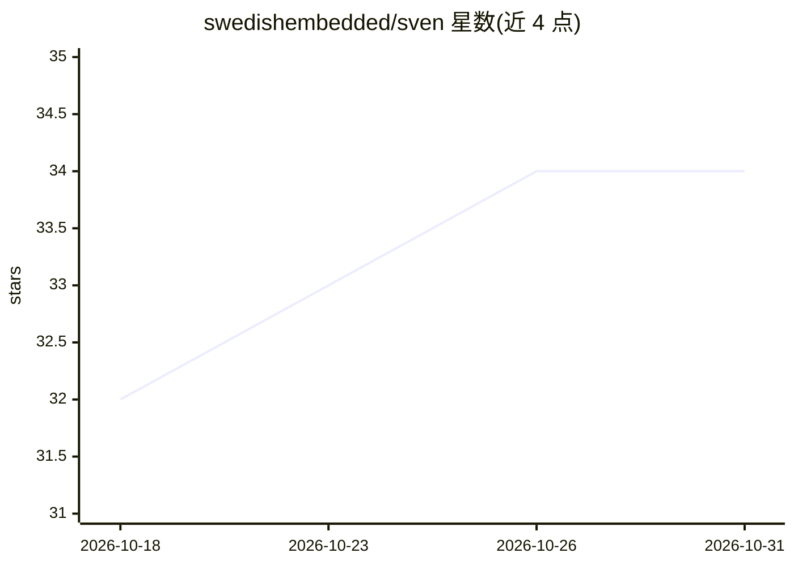

# swedishembedded/sven

⭐ 34 · Rust · Apache-2.0 · 推送 2026-10-30 · [GitHub](https://github.com/swedishembedded/sven) · [官网](https://agentsven.com) · 组织维护

**Rust 编写的终端 AI agent：读码、执行命令、完成任务的 TUI 与 CI 运行器**

用 Rust 构建的键盘驱动终端 AI agent，以交互式 TUI 和无头 CI 运行器两种形态工作，底层共用一个分层状态机内核：模型只提议动作、不驱动执行。能力包括读代码、运行命令、写文件、搜索网页、向子 agent 委派任务，支持超过三十个模型提供方、MCP 客户端/服务器与 ACP 编辑器协议，并有 sven-sdk 将内核嵌入自有应用。可配套同栈项目 brain 在本地硬件上提供模型服务，无需云账号；也支持 OpenRouter 等托管提供方的 API key。提供安装脚本与源码构建两种安装方式，Apache 2.0 许可。

## 筛选速览

| 维度 | 判定 | 备注 |
|---|---|---|
| AI 角色 | `ai-native` | 本体是模型或模型工具 |
| 许可风险 | `permissive` | Apache-2.0 |
| 部署形态 | `None` |  |
| 模型依赖 | locked-api |  |
| 硬件要求 | — | 无带数字的原话,不猜 |
| 安装摩擦 | `low` | 无编译、无系统依赖或容器化 |
| 成熟度 | — | 结构信号不足 |

## 能力要点

- TUI 与无头 CI 共用同一 HSM 内核，模型提议动作但不驱动执行
- 工具与委派：文件/搜索/shell/web/GDB 与子 agent 团队任务板
- 三十余个模型提供方，支持 MCP 客户端/服务器与 ACP
- sven-sdk 嵌入内核；harness 以 YAML 定义可验证任务

## 适用场景

- 在终端里用自然语言让 agent 读代码、执行命令并完成开发任务
- 用 Markdown workflow 文件在 CI 中无头运行 agent
- 通过 brain 在本地硬件服务模型，配合托管模型并行使用

## 场景标签

`编码 Agent` · 领域:编码与开发

## 证据(README 行号)

> L15: Give sven a task in plain English. It reads your code, runs commands, writes
> L27: |**sven** (this repository)|**Runs the agent.** A terminal AI agent that reads code, runs tools and works through t

## 星数曲线

2026-10-18 32 → 2026-10-31 34（+2）

---
*卡片 v1 · prompt 1.4 · 生成 2026-10-25 · 置信度 high · 依据 README sha `9cbd3d783a62` · [字段定义](../../DATASET.md)*
