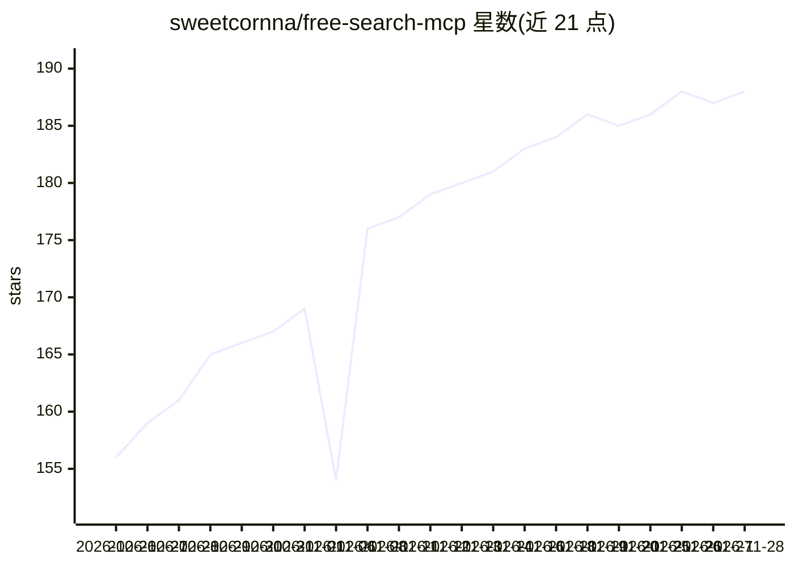

# sweetcornna/free-search-mcp

⭐ 188 · Rust · MIT · 推送 2026-11-27 · [GitHub](https://github.com/sweetcornna/free-search-mcp) · [官网](https://github.com/ymylive/free-search-mcp) · 个人维护

**给 MCP 客户端提供免 API key 的本地网页搜索与文档读取服务**

单二进制 Rust 实现的 Model Context Protocol 服务器，无需 API key 或注册即可运行。对外暴露 search、exec、ask 三个工具，聚合 500+ 网络、学术与专业数据源，支持多引擎网页搜索（DuckDuckGo、Mojeek 等）、学术子系统（引用图谱、撤稿检查、OA 全文）、本地文档解析（PDF/DOCX 等）、FTS5 缓存与沙箱化 JavaScript 执行。默认路径不依赖 LLM；可选配置 answer agent 后端。面向使用 Claude Code、Codex、Antigravity 等 MCP 客户端的用户。

## 筛选速览

| 维度 | 判定 | 备注 |
|---|---|---|
| AI 角色 | `ai-ecosystem` | LLM/agent 周边工具 |
| 许可风险 | `permissive` | MIT |
| 部署形态 | `self-host` | docker 或自建部署 |
| 模型依赖 | — | README 未给出锁定关系 |
| 硬件要求 | — | 无带数字的原话,不猜 |
| 安装摩擦 | `low` | 无编译、无系统依赖或容器化 |
| 成熟度 | — | 结构信号不足 |

## 能力要点

- 仅暴露 3 个工具，聚合 500+ 网络/学术/专业数据源
- 默认引擎均无需 API key 与账号，冷启动 ≤15 ms
- 沙箱 QuickJS-NG 中批量抓取并读取 PDF/DOCX/XLSX/PPTX/EPUB
- Retraction Watch 本地索引与 offline hayagriva 引用生成

## 适用场景

- 让 Claude Code 等 MCP 客户端直接进行联网搜索与网页阅读
- 在一次 exec 调用中完成论文检索、引用图谱与撤稿核查
- 无 API key 环境下为 agent 提供本地优先的搜索工具
- 通过 CLI 或 HTTP 端点做快速带来源的查询

## 场景标签

`文档解析` `科研工具` `网页抓取` · 领域:效率与自动化

## 证据(README 行号)

> L11: `free-search-mcp` 1.0 is a single-binary, local-first Rust Model Context
> L37: Claude Code, Codex, and Antigravity (`agy`) are equal first-class targets. All
> L85: |`ask(question, freshness?, lang?, domains?, mode?, max_tokens?)`|Quick one-call lookup with no code (`mode`: `"aut

## 星数曲线

2026-10-26 156 → 2026-11-28 188（+32）

---
*卡片 v1 · prompt 1.4 · 生成 2026-11-27 · 置信度 high · 依据 README sha `250934f582bd` · [字段定义](../../DATASET.md)*
