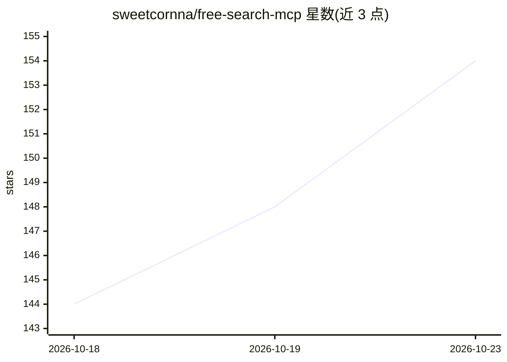

# sweetcornna/free-search-mcp

⭐ 154 · Python · MIT · 推送 2026-10-22 · [GitHub](https://github.com/sweetcornna/free-search-mcp) · [官网](https://github.com/ymylive/free-search-mcp) · 个人维护 · 中文 README

**本地优先、免 API key 的网页搜索/抓取/文档阅读 MCP 服务器**

面向任意 LLM 客户端（Claude、GPT、本地 Ollama 模型等）的 Model Context Protocol 服务器：提供 11 个工具，覆盖多引擎并行搜索（DuckDuckGo/Bing/Mojeek 等 RRF 合并）、页面抓取与 Markdown 清洗、PDF/DOCX/EPUB 等文档分页阅读、FTS5 本地缓存检索与引文图谱查询。所有默认引擎无需 API key，遇验证码/登录墙时自动切换备用引擎，可选 Playwright Chromium 渲染。以 uvx 一条命令运行，另有 Claude Code/Codex 插件、Docker 与 HTTP 传输等方式；HTTP 端点默认无鉴权，需留在回环地址或加代理。

## 筛选速览

| 维度 | 判定 | 备注 |
|---|---|---|
| AI 角色 | `ai-ecosystem` | LLM/agent 周边工具 |
| 许可风险 | `permissive` | MIT |
| 部署形态 | `self-host` | docker 或自建部署 |
| 模型依赖 | — | README 未给出锁定关系 |
| 硬件要求 | — | 无带数字的原话,不猜 |
| 安装摩擦 | `low` | 无编译、无系统依赖或容器化 |
| 成熟度 | — | 结构信号不足 |

## 能力要点

- 11 个工具：多引擎搜索、research 一次调用、引文图谱、并发抓取、多格式文档阅读
- 默认引擎池全部无需 API key，含 CAPTCHA/登录墙检测与备用引擎顶替
- FTS5 本地缓存与 freshness/max_age 等时效过滤
- Markdown 优先输出，带出处与 token 估计

## 适用场景

- 让 Claude/Codex 等 agent 无需注册搜索 API 即可联网检索
- 研究型问答：一次 research 调用返回多来源 Markdown 简报
- 读取并分页解析 PDF/DOCX/EPUB 等文档供 LLM 使用
- 复检已抓取页面的本地全文缓存

## 场景标签

`网页抓取` `文档解析` · 领域:效率与自动化

## 证据(README 行号)

> L11: free-search-mcp is a local-first Model Context Protocol server that needs no
> L12: API key. It lets any LLM (Claude, GPT, a local Ollama model, …) search the web,

## 星数曲线

2026-10-18 144 → 2026-10-23 154（+10）

---
*卡片 v1 · prompt 1.4 · 生成 2026-10-23 · 置信度 mid · 依据 README sha `728048017f5f` · [字段定义](../../DATASET.md)*
