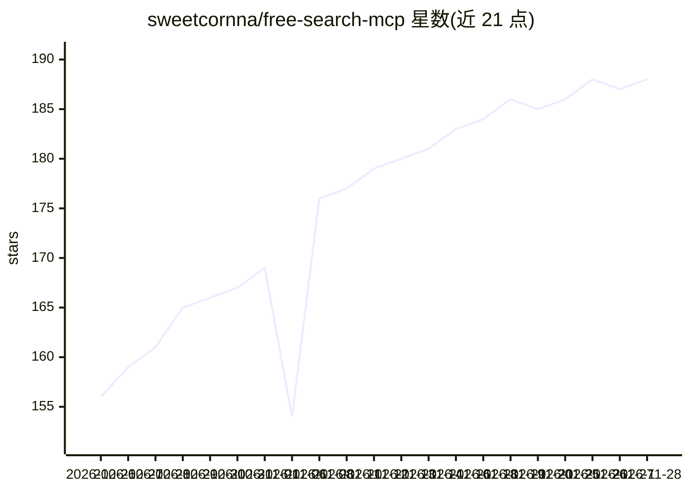

# sweetcornna/free-search-mcp

⭐ 188 · Rust · MIT · 推送 2026-11-27 · [GitHub](https://github.com/sweetcornna/free-search-mcp) · [官网](https://github.com/ymylive/free-search-mcp) · 个人维护

**无需 API key 的本地 MCP 搜索服务器，供 AI 客户端检索网页与文献**

以 Rust 编写、单二进制的 Model Context Protocol 服务器，暴露 search/exec/ask 三个工具，聚合 500+ 网页、学术与垂直来源，支持 DuckDuckGo、Mojeek、Startpage 等无密钥引擎，内置学术子系统（引文图谱、OA 全文、Retraction Watch）、本地文档解析与 FTS5 缓存。面向 Claude Code、Codex、Antigravity 等 MCP 客户端用户，通过插件、uvx、独立二进制、Docker 等方式安装，默认无需任何 API key 或注册。

## 筛选速览

| 维度 | 判定 | 备注 |
|---|---|---|
| AI 角色 | `ai-ecosystem` | LLM/agent 周边工具 |
| 许可风险 | `permissive` | MIT |
| 部署形态 | `self-host` | docker 或自建部署 |
| 模型依赖 | — | README 未给出锁定关系 |
| 硬件要求 | — | 无带数字的原话,不猜 |
| 安装摩擦 | `low` | 无编译、无系统依赖或容器化 |
| 成熟度 | — | 结构信号不足 |

## 能力要点

- 暴露 search/exec/ask 三个工具，覆盖 500+ 网页、学术与垂直来源
- 无需 API key 与注册，冷启动 ≤15 ms，二进制约 20 MB
- 学术子系统：引文图谱、 lawful OA 全文、Retraction Watch 撤稿检查
- 沙箱化 QuickJS-NG 执行环境，可读 PDF/DOCX/XLSX/PPTX/EPUB

## 适用场景

- 让 Claude Code 等 MCP 客户端直接联网搜索并读取网页
- 在本地完成学术论文检索、引文核查与 OA 全文获取
- 解析本地 PDF/Office/EPUB 文档并纳入检索流程

## 场景标签

`文档解析` `科研工具` `网页抓取` · 领域:效率与自动化

## 证据(README 行号)

> L11: `free-search-mcp` 1.0 is a single-binary, local-first Rust Model Context
> L12: Protocol server that needs **no API key** and **no signup**. It exposes exactly
> L37: Claude Code, Codex, and Antigravity (`agy`) are equal first-class targets. All

## 星数曲线

2026-10-26 156 → 2026-11-28 188（+32）

---
*卡片 v1 · prompt 1.4 · 生成 2026-11-28 · 置信度 high · 依据 README sha `72b5dd1f02a1` · [字段定义](../../DATASET.md)*
