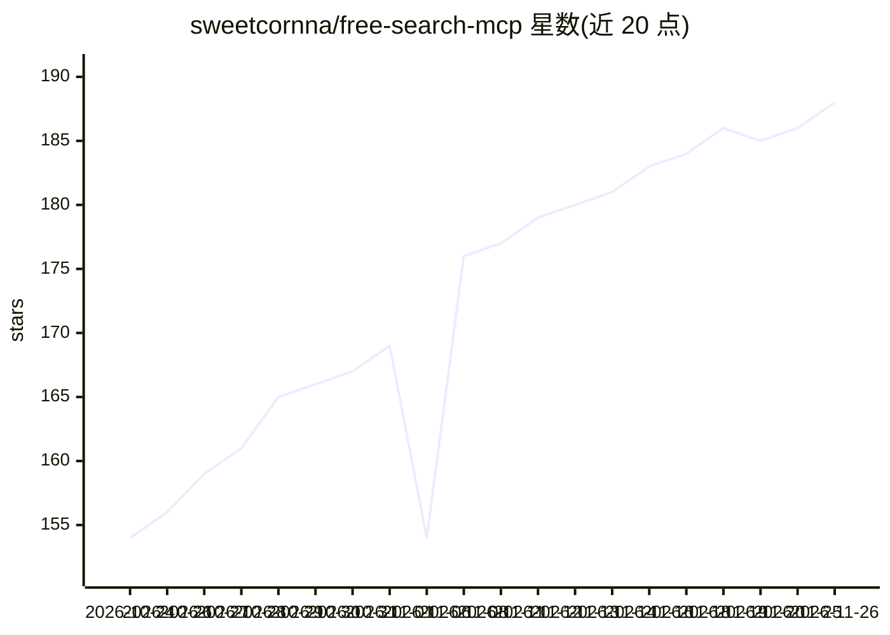

# sweetcornna/free-search-mcp

⭐ 188 · Python · MIT · 推送 2026-11-17 · [GitHub](https://github.com/sweetcornna/free-search-mcp) · [官网](https://github.com/ymylive/free-search-mcp) · 个人维护

**无需 API key 的本地 MCP 服务器，为 LLM 提供网页搜索与文档读取**

以 Model Context Protocol 服务器形式运行，为任意 LLM 客户端提供 11 个工具：多引擎并行搜索（RRF 合并、去重）、一次性 research()、PDF/DOCX/XLSX 等文档解析、URL 抓取与结构化元数据抽取、FTS5 缓存检索与下载。默认使用 duckduckgo、bing、yahoojp 等 keyless 引擎池，遇到 CAPTCHA 或登录墙时自动换用备用引擎；可选安装 Chromium 以渲染 JavaScript 页面。通过 Claude Code/Codex 插件、MCP Registry、uvx 命令或 Docker 分发。

## 筛选速览

| 维度 | 判定 | 备注 |
|---|---|---|
| AI 角色 | `ai-ecosystem` | LLM/agent 周边工具 |
| 许可风险 | `permissive` | MIT |
| 部署形态 | `self-host` | docker 或自建部署 |
| 模型依赖 | — | README 未给出锁定关系 |
| 硬件要求 | — | 无带数字的原话,不猜 |
| 安装摩擦 | `low` | 无编译、无系统依赖或容器化 |
| 成熟度 | — | 结构信号不足 |

## 能力要点

- 11 个 MCP 工具：搜索、research、引文图谱、批量抓取、文档解析、FTS5 缓存检索
- 默认 keyless 引擎池，CAPTCHA/登录墙自动切换备用引擎
- 支持 freshness、include/exclude_domains、category 等过滤器，输出 Markdown 含来源与 token 估计
- 可选登录 codex/antigravity 账号作为附加搜索引擎

## 适用场景

- 让 Claude Code 或 Codex 具备网页搜索与页面抓取能力
- 阅读本地或在线 PDF/DOCX 等文档并分页解析
- 按类别检索论文、CVE、数据集等专业来源
- 无需注册搜索 API 即可搭建 LLM 联网检索

## 场景标签

`文档解析` `网页抓取` · 领域:效率与自动化

## 证据(README 行号)

> L11: free-search-mcp is a local-first Model Context Protocol server that needs no
> L12: API key. It lets any LLM (Claude, GPT, a local Ollama model, …) search the web,
> L55: `free-search:quick-search` agent, all pinned to one version.

## 星数曲线

2026-10-24 154 → 2026-11-26 188（+34）

---
*卡片 v1 · prompt 1.4 · 生成 2026-11-26 · 置信度 mid · 依据 README sha `ed6a7fc26229` · [字段定义](../../DATASET.md)*
