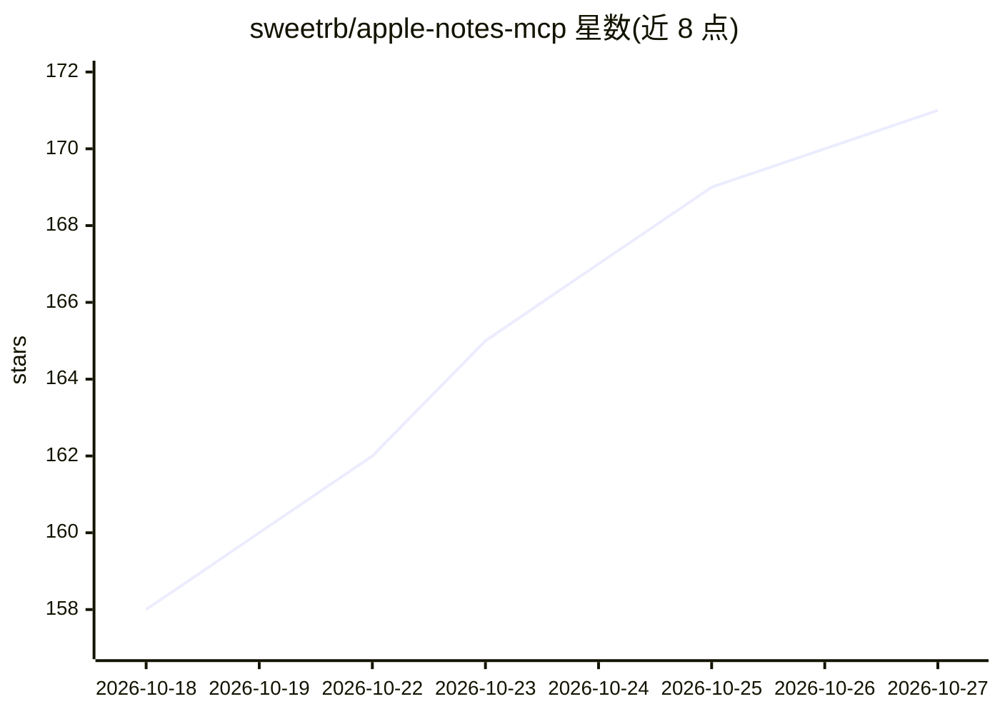

# sweetrb/apple-notes-mcp

⭐ 171 · TypeScript · MIT · 推送 2026-10-26 · [GitHub](https://github.com/sweetrb/apple-notes-mcp) · 个人维护

**让 AI 助手读写管理 macOS Apple Notes 的 MCP 服务器**

本地运行的 Model Context Protocol 服务器，通过 stdio 与 Claude Code/Claude Desktop、Codex、Hermes、Antigravity、Gemini Spark 等 MCP 客户端通信，再用 AppleScript、打包签名的 Apple Shortcuts 和只读数据库访问操作 Mac 上的 Apple Notes：支持读写、搜索、文件夹/账户管理、原生标签、清单、表格、置顶、附件，并可导出 Markdown/HTML/JSON、读取音频转写与绘图、段落锚点链接及全库查询语言。需 macOS + Node.js 20+，数据库类操作需完全磁盘访问权限；不提供 HTTP/SSE/WebSocket 端点。

## 筛选速览

| 维度 | 判定 | 备注 |
|---|---|---|
| AI 角色 | `ai-ecosystem` | LLM/agent 周边工具 |
| 许可风险 | `permissive` | MIT |
| 部署形态 | `library` | 以包/库形式分发 |
| 模型依赖 | — | README 未给出锁定关系 |
| 硬件要求 | — | 无带数字的原话,不猜 |
| 安装摩擦 | `low` | 无编译、无系统依赖或容器化 |
| 成熟度 | — | 结构信号不足 |

## 能力要点

- 通过 AppleScript / Apple Shortcuts / 只读数据库三种途径访问 Apple Notes
- 导出 Markdown（可本地网页编辑模板）/HTML（绘图转 SVG）/JSON，读取音频转写
- 段落锚点在编辑后仍可解析，附全库查询语言
- 仅本地 stdio 传输，无远程 HTTP/SSE/OAuth 端点

## 适用场景

- 让 Claude 或 Codex 帮我保存对话纪要、查找和整理笔记
- 把 Apple Notes 笔记导出为 Markdown 归档
- 用 AI 助手按文件夹、标签组织和移动笔记

## 场景标签

`知识库管理` · 领域:知识与检索

## 证据(README 行号)

> L3: A Model Context Protocol (MCP) server that lets Claude (Claude Code and Claude Desktop), Codex, and other MCP client
> L30: The AI assistant communicates with this server, which then uses AppleScript to interact with the Notes app on your 
> L34: Apple Notes MCP runs on the Mac that holds your Notes library. Your assistant starts a local MCP server over **stdi

## 星数曲线

2026-10-18 158 → 2026-10-27 171（+13）

---
*卡片 v1 · prompt 1.4 · 生成 2026-10-22 · 置信度 high · 依据 README sha `f13cc24f5310` · [字段定义](../../DATASET.md)*
