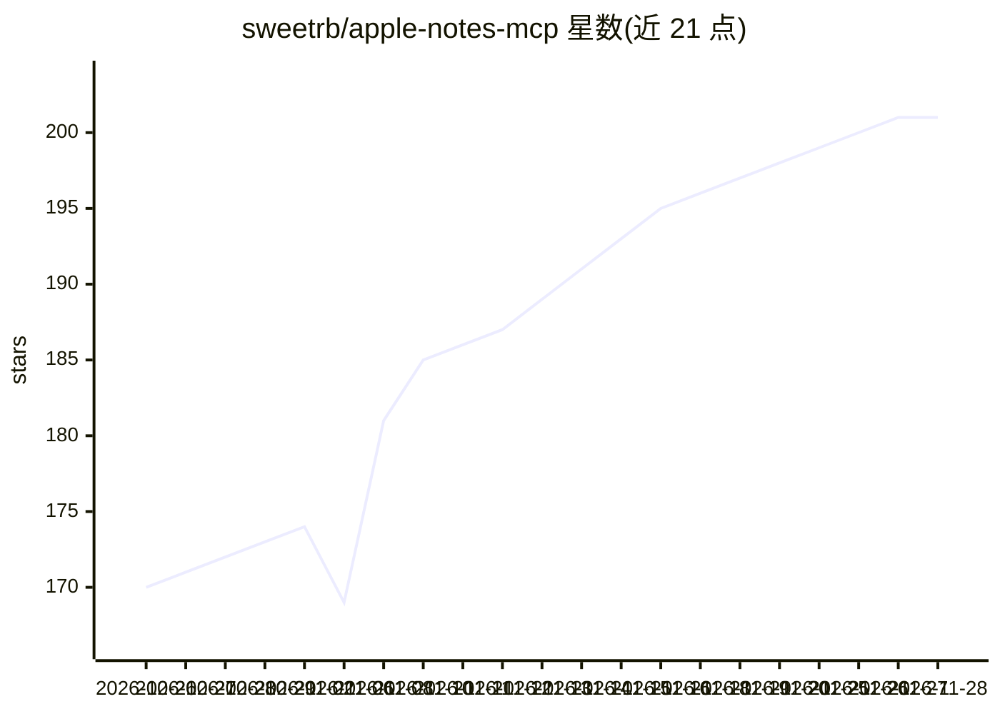

# sweetrb/apple-notes-mcp

⭐ 201 · TypeScript · MIT · 推送 2026-11-25 · [GitHub](https://github.com/sweetrb/apple-notes-mcp) · 个人维护

**macOS 上的 Apple Notes MCP 服务器，供 AI 助手读写管理笔记**

在 macOS 本地运行的 Model Context Protocol 服务器，通过 AppleScript、Apple Shortcuts 与只读数据库访问，让 Claude Code、Claude Desktop、Codex 等 MCP 客户端读取、搜索、创建、编辑、整理并导出 Apple Notes 笔记。功能覆盖文件夹与账户管理、原生标签、清单、表格、置顶、附件，支持以 Markdown/HTML/JSON 导出，提供本地 Web 模板编辑器与查询语言。需 macOS、Node.js 20+、自动化与完全磁盘访问权限，部分功能依赖 macOS 版本与 iCloud 账户。

## 筛选速览

| 维度 | 判定 | 备注 |
|---|---|---|
| AI 角色 | `ai-ecosystem` | LLM/agent 周边工具 |
| 许可风险 | `permissive` | MIT |
| 部署形态 | `library` | 以包/库形式分发 |
| 模型依赖 | — | README 未给出锁定关系 |
| 硬件要求 | — | 无带数字的原话,不猜 |
| 安装摩擦 | `low` | 无编译、无系统依赖或容器化 |
| 成熟度 | — | 结构信号不足 |

## 能力要点

- 支持 Claude Code、Claude Desktop、Codex、Hermes、Antigravity 等多种客户端注册方式
- 管理标签、清单、表格、置顶、链接与附件，支持 Markdown/HTML/JSON 导出
- 本地通过 AppleScript 与签名的 Apple Shortcuts 操作 Notes，语音转录在设备端运行
- 提供 npm 包分发，v2.15.1 含可选权限 broker

## 适用场景

- 让 AI 助手把对话内容保存为 Apple Notes 笔记
- 用自然语言搜索和整理 Mac 上的笔记库
- 将笔记批量导出为 Markdown 或 HTML

## 场景标签

`知识库管理` · 领域:知识与检索

## 证据(README 行号)

> L3: A Model Context Protocol (MCP) server that lets Claude (Claude Code and Claude Desktop), Codex, and other MCP client
> L34: Apple Notes MCP runs on the Mac that holds your Notes library. Your assistant starts a local MCP server over **stdi
> L46: - A client that can launch a local stdio MCP server on this Mac. The configurations below cover Claude Code, Claude

## 星数曲线

2026-10-26 170 → 2026-11-28 201（+31）

---
*卡片 v1 · prompt 1.4 · 生成 2026-11-25 · 置信度 high · 依据 README sha `591d3525b27e` · [字段定义](../../DATASET.md)*
