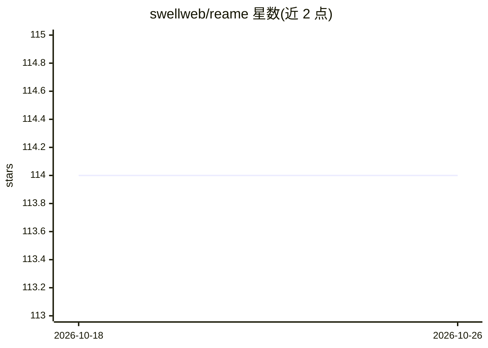

# swellweb/reame

⭐ 114 · C++ · MIT · 推送 2026-10-12 · [GitHub](https://github.com/swellweb/reame) · [官网](https://swellweb.github.io/reame/) · 组织维护

**面向普通 CPU 的 LLM 推理服务器，主打三值模型与免费云实例**

自研 LLM 服务器，面向 CPU（含免费档 ARM 实例）运行三值模型（权重为 -1/0/+1），8B 模型占 2.2 GB 内存。内部含两个引擎：自研 nucleo（处理三值模型，一次性转换为 .nuc 格式，支持前缀缓存、预热接口、小模型向大模型的升级中继）与 llama.cpp（运行常规 GGUF）。对外提供 OpenAI 兼容 API（chat/completions、warm、sessions、metrics 等端点），从源码构建，构建依赖 CMake、C++20、Boost、nlohmann-json、zstd。README 声明不适用于通用聊天、agent 编码与长文创作场景。

## 筛选速览

| 维度 | 判定 | 备注 |
|---|---|---|
| AI 角色 | `ai-ecosystem` | LLM/agent 周边工具 |
| 许可风险 | `permissive` | MIT |
| 部署形态 | `None` |  |
| 模型依赖 | local-ok | 支持本地模型 |
| 硬件要求 | `cpu-ok` | |
| 安装摩擦 | `medium` | 含编译或系统依赖之一 |
| 成熟度 | — | 结构信号不足 |

## 能力要点

- nucleo 引擎一次性转换 .nuc 格式，启动仅占 99 MB 内存
- 跨请求/重启复用的磁盘前缀缓存与 /v1/warm 预读接口
- OpenAI 兼容 API，含 SSE 流式、会话快照与 metrics 端点
- 小模型失败时经 [escalation] 中继升级到更大模型

## 适用场景

- 在免费档 ARM 云实例上自托管一个小型 LLM 服务
- 给网站加一个从自有数据库逐字取值、结构上无法编造价格的问答组件
- 夜间批量任务（打标签、邮件分诊）零 token 成本运行
- 用 €5 级 VPS 给薄利 SaaS 加 AI 功能或私有代码补全端点

## 场景标签

`推理引擎` · 领域:训练与推理

## 证据(README 行号)

> L5: **Reame is an LLM server designed for ordinary CPUs, specifically built around ternary models — where weights are st
> L16: No GPU required. No per-token billing. Just a single OpenAI-compatible API that any existing client can connect to.
> L43: curl http://127.0.0.1:8080/v1/chat/completions -d '{

## 星数曲线

2026-10-18 114 → 2026-10-26 114（+0）

---
*卡片 v1 · prompt 1.4 · 生成 2026-10-23 · 置信度 high · 依据 README sha `d370225c58d6` · [字段定义](../../DATASET.md)*
