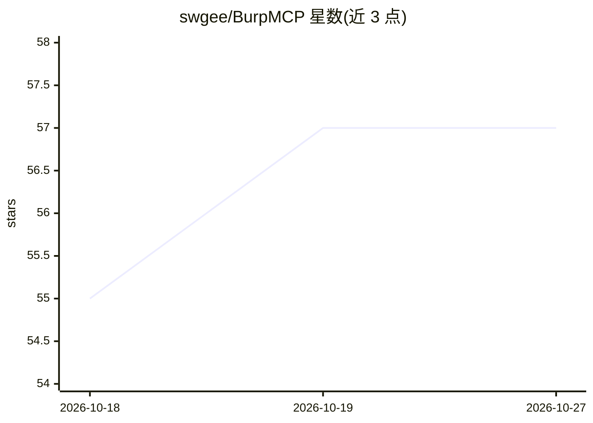

# swgee/BurpMCP

⭐ 57 · Java · MIT · 推送 2026-01-21 · [GitHub](https://github.com/swgee/BurpMCP) · 个人维护

**Burp Suite 的 MCP Server 扩展：让 LLM 代替人工做 Web 安全测试**

Burp Suite 扩展，内置 MCP Server 对接 Burp 扩展 API，使 Claude Desktop、Cursor、Cline 等 MCP 客户端中的模型能检索保存的请求、发送 HTTP/1.1 与 HTTP/2 请求、用正则改写重发请求、生成 Collaborator 载荷做带外测试。面向应用安全测试人员、漏洞研究员与赏金猎人，全程可查看模型动作。默认 SSE 模式监听 localhost:8181，STDIO 客户端需另装 stdio-bridge.py；已知限制：LF→CRLF 替换会影响 HTTP/1.1 请求走私测试。

## 筛选速览

| 维度 | 判定 | 备注 |
|---|---|---|
| AI 角色 | `ai-ecosystem` | LLM/agent 周边工具 |
| 许可风险 | `permissive` | MIT |
| 部署形态 | `library` | 以包/库形式分发 |
| 模型依赖 | — | README 未给出锁定关系 |
| 硬件要求 | — | 无带数字的原话,不猜 |
| 安装摩擦 | `low` | 无编译、无系统依赖或容器化 |
| 成熟度 | — | 结构信号不足 |

## 能力要点

- MCP 客户端可检索保存的请求并发送后续 HTTP/1.1、HTTP/2 请求
- 正则替换重发请求（类似面向 LLM 的 Repeater）
- 生成 Collaborator 载荷并取回交互记录，支持带外测试
- Server logs 标签页可查看全部 MCP 消息便于调试

## 适用场景

- 让 Claude/Cursor 等 MCP 客户端代为执行 Web 应用的手工渗透测试
- 在 Burp 中保存请求并附注，供 LLM 检索分析
- 用 LLM 驱动带外（out-of-band）漏洞检测

## 场景标签

`网络安全` · 领域:学习与行业

## 证据(README 行号)

> L9: BurpMCP focuses on enhancing manual application security testing with the help of LLMs by integrating Burp Suite wit
> L19: The extension starts an MCP Server that interfaces directly with the Burp Suite extension API. For more information

## 星数曲线

2026-10-18 55 → 2026-10-27 57（+2）

---
*卡片 v1 · prompt 1.4 · 生成 2026-10-24 · 置信度 mid · 依据 README sha `ab9b67c10792` · [字段定义](../../DATASET.md)*
