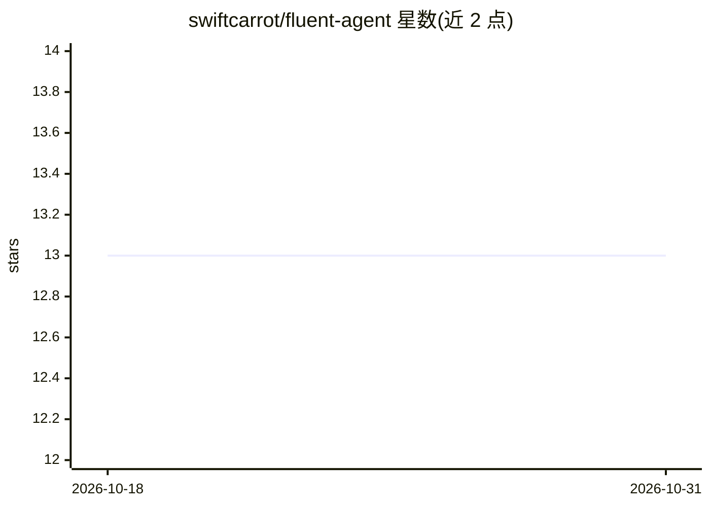

# swiftcarrot/fluent-agent

⭐ 13 · TypeScript · Apache-2.0 · 推送 2025-12-30 · [GitHub](https://github.com/swiftcarrot/fluent-agent) · [官网](https://fluent.swiftcarrot.com) · 个人维护

**TypeScript 开发者的多 AI 服务商统一调用工具库**

基于 Zod 构建的 TypeScript AI 工具库，为开发者提供对 anthropic、openai、ollama、google、elevenlabs、fal、voyage 等多个 AI 服务商的统一封装。核心机制是 Job API：每次请求封装为可序列化/反序列化的 Job 对象，支持方法链式调用与 JSON 声明式创建，并提供 TypeScript 类型定义、Zod Schema 与 JSON Schema。功能覆盖聊天补全、函数调用、流式输出、嵌入、图像生成、模型列表与文本转语音。项目处于 beta 阶段，API 可能变动。

## 筛选速览

| 维度 | 判定 | 备注 |
|---|---|---|
| AI 角色 | `ai-ecosystem` | LLM/agent 周边工具 |
| 许可风险 | `permissive` | Apache-2.0 |
| 部署形态 | `library` | 以包/库形式分发 |
| 模型依赖 | local-ok | 支持本地模型 |
| 硬件要求 | — | 无带数字的原话,不猜 |
| 安装摩擦 | `low` | 无编译、无系统依赖或容器化 |
| 成熟度 | `idea` | |

## 能力要点

- 统一封装 7 个 AI 服务商的聊天、嵌入、图像生成、TTS 等能力
- Job 对象可序列化/反序列化，支持链式与 JSON 声明式创建
- 内置 TypeScript 类型定义、Zod Schema 与 JSON Schema
- 文本、对象、工具调用的流式输出支持

## 适用场景

- TypeScript 项目中接入多个 AI 服务商而不逐家对接 SDK
- 把 AI 请求作为可持久化的任务对象存入队列或数据库后执行
- 构建带函数调用与流式输出的聊天应用

## 场景标签

`模型网关` · 领域:Agent 开发

## 证据(README 行号)

> L9: fluent-ai is a lightweight, type-safe AI toolkit that seamlessly integrates multiple AI providers. It features struc
> L21: fluent-ai includes support for multiple AI providers and modalities.

## 星数曲线

2026-10-18 13 → 2026-10-31 13（+0）

---
*卡片 v1 · prompt 1.4 · 生成 2026-10-31 · 置信度 high · 依据 README sha `0f5090db1cc6` · [字段定义](../../DATASET.md)*
