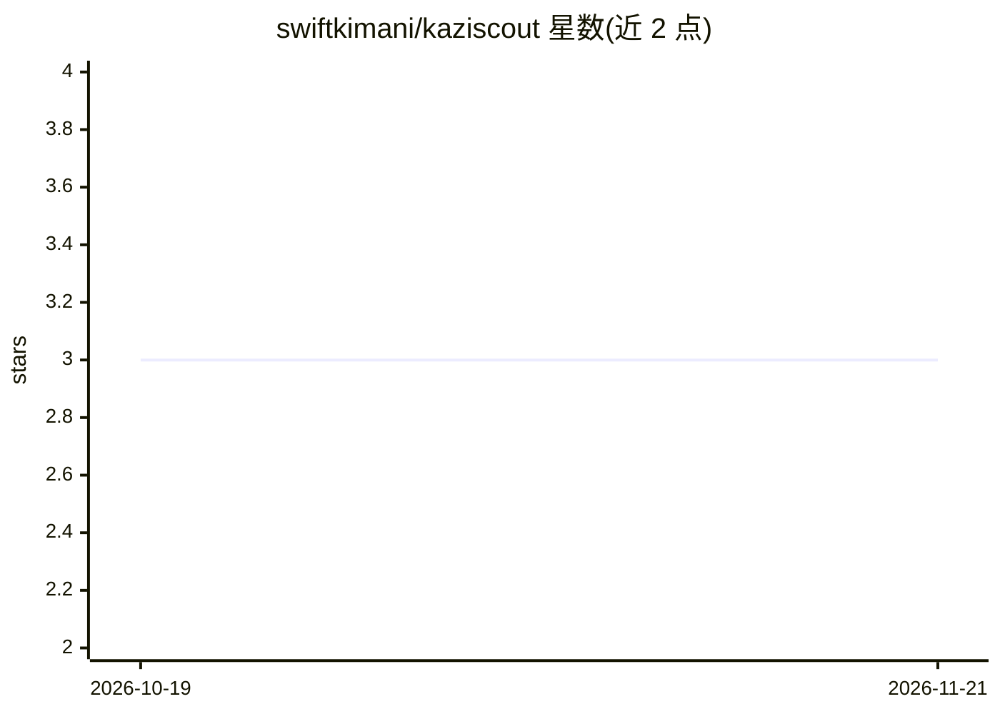

# swiftkimani/kaziscout

⭐ — · [GitHub]() · 个人维护

**在本地运行的非洲求职 agent：读职位板、按简历打分、跟踪申请**

KaziScout 是一个跑在用户自己电脑上的求职工具：读取 131 个职位来源（非洲职位板最深，支持任何国家），对每个职位按简历做 1-5 分离线关键词评分并给出理由，将职位页转为 Markdown，并提供申请跟踪器。支持网页、终端或 AI 编码工具三种使用方式；可选接入 OpenAI 兼容服务或本地模型以生成更完整评估、求职信与定制简历，无模型时其余功能仍可用。数据存于单个 SQLite 文件；需 Node.js 24 与 pnpm，从源码安装。

## 筛选速览

| 维度 | 判定 | 备注 |
|---|---|---|
| AI 角色 | `ai-enhanced` | 去掉 AI 部分产品仍成立 |
| 许可风险 | `viral` | — |
| 部署形态 | `library` | 以包/库形式分发 |
| 模型依赖 | local-ok | 支持本地模型 |
| 硬件要求 | — | 无带数字的原话,不猜 |
| 安装摩擦 | `low` | 无编译、无系统依赖或容器化 |
| 成熟度 | — | 结构信号不足 |

## 能力要点

- 读取 131 个职位来源：25 个公开 feed/API 职位板与 7 家招聘系统的雇主招聘页
- 从 PDF/Word/文本/Markdown 简历自动生成个人档案并追问补充信息
- 离线 1-5 分评分，按标题、技能、地点、新鲜度拆解理由
- 接入模型后生成求职信与定制简历，遵守'reword, never invent'规则

## 适用场景

- 搜索非洲及全球远程职位并按简历匹配度排序
- 跟踪投递状态并收到新强匹配的定时提醒
- 根据职位发布内容定制求职信与简历

## 场景标签

`AI 写作` · 领域:内容生成

## 证据(README 行号)

> L28: |**Works with any AI model**|Connect OpenAI, Gemini, DeepSeek, Groq, OpenRouter, Claude, or a free local model thro
> L37: Everything is stored in one SQLite file on your machine. Nothing leaves it except the requests

## 星数曲线

2026-10-19 3 → 2026-11-21 3（+0）

---
*卡片 v1 · prompt 1.4 · 生成 2026-11-21 · 置信度 mid · 依据 README sha `503c64d7d4e6` · [字段定义](../../DATASET.md)*
